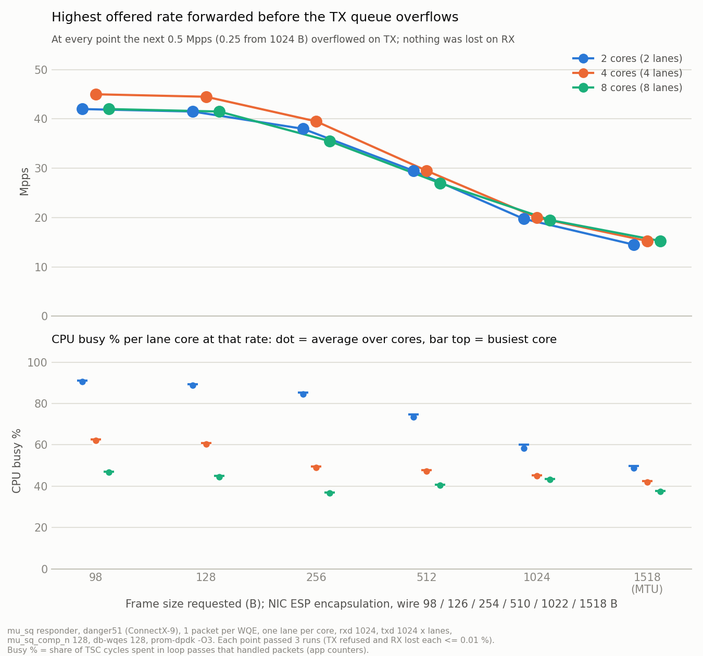
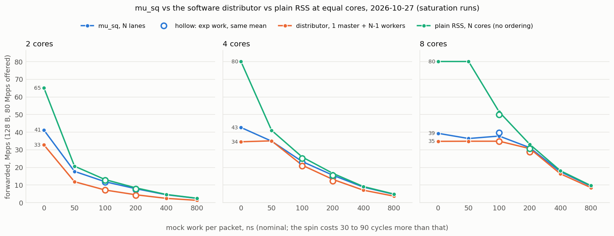
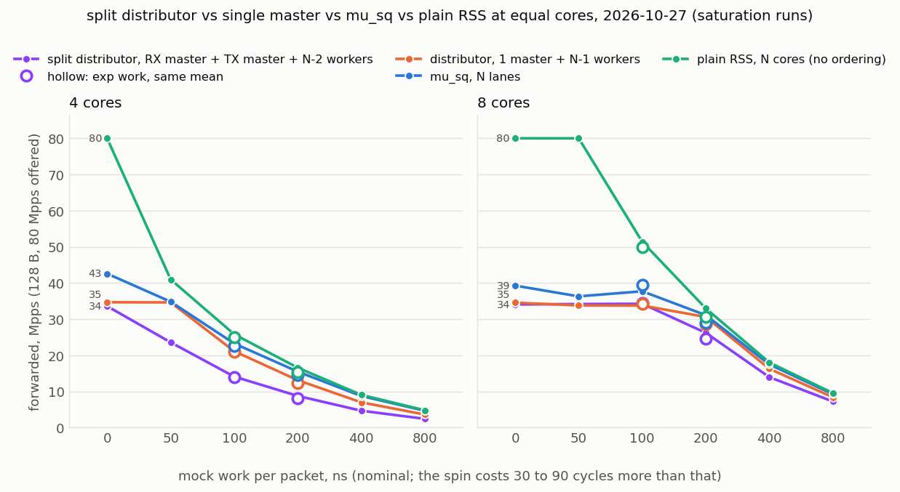
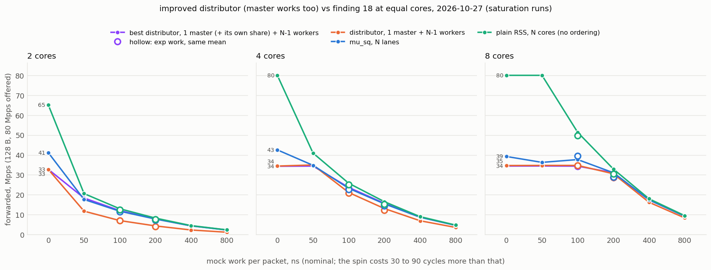

# mu_sq TX investigation: status 2026-10-08

Where the investigation of mu_sq TX drops on the esp_rr responder stands, what
has been ruled out, the tools added for it, and what to run next. Throughput
ceilings of the requester and the plain RSS responder are in
[throughput.md](throughput.md).

## Where things stand (2026-10-08)

Terms: mu_sq ("multi-user SQ", PROM) is one hardware send queue shared by
several cores; each core owns a *lane*, every N-th slot of the shared ring, and
the NIC sends the slots in ring order. The *responder* (danger51, this repo's
app on the prom-dpdk mlx5 PMD) receives packets and sends them back; the
*requester* (danger50, same app, stock PMD) generates the traffic.

- **Open question.** Two cores on a 2-lane group stop at about 35 Mpps with the
  defaults and at about 36.2 Mpps with fewer doorbells and completions
  (`--db-wqes 128`, `mu_sq_comp_n=64`, finding 13). At that wall the lanes
  have CPU left and nothing unread, so the NIC is what is behind. What limits
  it at 36.2 M one-packet WQEs per second on one SQ is not known. See findings
  11 and 13 and "Next steps".
- **Code.** Nothing since commit c19696c here and 99f4395ca1 in prom-dpdk
  (branch prom-main) is committed; both trees carry all the work described
  below as uncommitted changes (prom-dpdk also holds the user's own uncommitted
  edits in mlx5_txq.c, mlx5_os.c, the DOCA SDK and l3fwd: leave those alone).
- **Binaries.** danger51: all four app build directories are current, and so
  are both PMDs: the 1-packet-slot one (`install-o2-nometa-ppw1`) and, since
  2026-10-09, the 32-packet one (`install-o2-nometa`; the previous library is
  `librte_net_mlx5.so.26.0.bak-before-2026-10-09` next to it). danger50: `build-nodoca` and `build-esphw`
  are current (`scripts/remote_build.sh danger50`).
- **Hosts.** Both were rebooted on 2026-10-08 and again on 2026-10-09.
  Hugepages, the 1 GB mounts and pause off were set again on both after each
  reboot; `kernel.numa_balancing` is still 1 on danger51 (finding 10). `/` on danger51 (which holds `/tmp`) has about 4 GB free; a lane-epoch
  CSV of 4 M records is 0.7 to 1 GB.
- **Working with the user.** They run their own responder and requester by
  hand between requests: check `pgrep -a -x musq-testapp` on both hosts before
  starting anything, stop only a process you started, and run tests only when
  the request asks for them.

## Host state to restore first

The setup below does not survive a reboot. Check it before any run.
`scripts/setup_hugepages_pause.sh danger51 danger50` sets the first four rows
(hugepages, mounts, pause off) on both hosts and prints the result.

| item | danger50 | danger51 | how to set |
|---|---|---|---|
| 1 GB hugepages | 4 per NUMA node | 4 per NUMA node | `echo 4 \| sudo tee /sys/devices/system/node/node{0,1}/hugepages/hugepages-1048576kB/nr_hugepages` |
| 2 MB hugepages | 2048 per NUMA node | 2048 per NUMA node | same with `hugepages-2048kB` and 2048 |
| 1 GB hugetlbfs mounts | `/mnt/huge-1G`, `/mnt/huge` | same | `sudo mount -t hugetlbfs -o pagesize=1G nodev /mnt/huge-1G` (and `/mnt/huge`) |
| global pause | off | off | `sudo ethtool -A enp23s0f1np1 rx off tx off` |
| automatic NUMA balancing | on (not changed, not tested there) | off | `sudo sysctl -w kernel.numa_balancing=0` |
| device IRQs off the lane CPUs | irqbalance running (not changed) | all on odd (node 1) CPUs, set 2026-10-18 | `echo aaaaaaaa \| sudo tee /proc/irq/default_smp_affinity`, then `seq -s, 1 2 31` into every `/proc/irq/*/smp_affinity_list` (megasas, dmar and the timer refuse; they do not fire on polling lanes) |
| swappiness, RT throttling | 0, -1 | 0, -1 | `sudo sysctl -w vm.swappiness=0 kernel.sched_rt_runtime_us=-1` |
| CPU governor on CPUs 0, 2-16 | performance (set 2026-10-22, again 2026-10-27 after the reboot) | performance (same) | `echo performance \| sudo tee /sys/devices/system/cpu/cpu{0,2,4,6,8,10,12,14,16}/cpufreq/scaling_governor`; with schedutil + nohz_full a lane core can stay at 1.4 GHz, which inflates busy % |

With pause on, a receiver that falls behind pauses the link and caps the
sender's TX, which makes every loss figure misleading. With NUMA balancing on,
the kernel runs its page scan inside the lane threads and stalls them for up to
1 ms (finding 10).

danger51 runs a rebuilt mlx5 PMD with per-lane WQ telemetry (see below). The
original library is kept next to it:

```
/homes/ofekdg/prom-dpdk/install-o2-nometa/lib/x86_64-linux-gnu/dpdk/pmds-26.0/
    librte_net_mlx5.so.26.0                        # with /mlx5/txq/lane_wq
    librte_net_mlx5.so.26.0.bak-before-lane-tel    # original, copy back to revert
```

It was built with `ninja -C build-o2-nometa drivers/librte_net_mlx5.so.26.0` and
copied into place. A full `meson install` was avoided because 37 unrelated
targets were pending in that build directory.

## Tools added

- **Responder summary** in every stats interval: RX/TX pps and wire Gbps, the
  rate offered at the port (`rx_phy_packets`), NIC discards
  (`rx_prio0_buf_discard_packets`), RX missed and not-forwarded packets.
- **`/mlx5/txq/lane_wq`** (prom-dpdk, `struct mlx5_txq_lane_tel`, switch
  `MLX5_MU_LANE_TELEMETRY`): each TX queue's own core records, inside its
  `rte_eth_tx_burst`, calls and packets offered and refused, free WQEBBs at each
  resource check (sum, min, latest, log2 histogram), and the WQEBBs a post needs
  (`room_need`). It writes only its own cache-aligned record from values the
  burst already computed, and the telemetry command reads only those records.
  No measurable overhead: 33.37 vs 33.30 Mpps on one CPU-bound core at 128 B.
- **Per-epoch lane log** (`--lane-epoch-us <us> --lane-epoch-out <csv>`,
  responder, DOCA build): every lane samples its own `wqe_ci`, `wqe_pi`, free
  WQEBBs and slot counters once per epoch on a common TSC grid (an epoch
  boundary is a multiple of the epoch length on the absolute TSC, so lanes agree
  on boundaries without sharing memory). The sample is taken by the lane's own
  lcore through `rte_pmd_mlx5_txq_lane_status()` (prom-dpdk), which reads only
  lane-owned state, into a log only that lcore writes; it is dumped as CSV after
  the workers stop. `scripts/lane_epoch_report.py <csv> --active-only` lines the
  lanes up by epoch and reports per-lane slots and short slots, skew and drift,
  the completion frontier and a timeline. Lanes sampled within 11 µs of each
  other in one epoch. Since 2026-10-08 each record also has the lane's CQ state
  (`cq_ci`, `cq_pi`, `cq_free`, and `cq_done`: completions the NIC has written
  that the lane has not consumed), through `rte_pmd_mlx5_txq_cq_status()`
  (prom-dpdk, installed in the 1-packet PMD only; README, "per-epoch lane
  log").
- **Doorbell count and control** (2026-10-09, README "Doorbell rate"): the PMD
  counts doorbell register writes per TX queue (`doorbells` in
  `/mlx5/txq/lane_wq`, `rte_pmd_mlx5_txq_burst_stats()`); the responder prints
  `TX doorbells/s` and `TX pkts/doorbell` per core and logs the count per
  epoch. `--db-wqes N` (devarg `mu_sq_db_wqes`) makes a lane ring once every N
  slots, from the slot close path, and not per send pass; a `rte_eth_tx_burst`
  of no packets rings what is held back, which the responder sends for a lane
  that was idle for `--tx-drain-us`. Installed in the 1-packet PMD only. Not
  yet run with traffic.
- **Software distributor** (2026-10-25, `--masters`; README, "Software
  distributor"): the software alternative to mu_sq for the comparison. A master
  lcore receives, deals the packets to worker lcores over SPSC rings, takes them
  back in arrival order (`--dist-order rr`: round-robin deal and collect, no
  sequence numbers; `seqn`: master-kept sequence numbers and a reorder buffer,
  optionally least-loaded dealing) and transmits on its own queue; the workers
  only process. Overload shows as RX missed (the master stops receiving when a
  worker is a ring behind), not as TX drops. Checked the same day (UDP 128 B,
  2 x 4 Mpps, `--work header`): every request matched for rr, seqn, seqn + lb,
  chunks of 8, immediate TX and two masters; the finding-9 stream test with
  `--work exp:300` on four workers is IDENTICAL for rr, seqn and seqn + lb; with
  1 us of work per packet the master holds RX and the excess shows as RX missed.
  At 8 Mpps the master costs about 290 cycles per packet with 5-packet bursts
  (per-pass overhead, not a ceiling). The plain responder path is unchanged by
  the shared per-packet code (`src/forward.hpp`): 38 cycles/pkt and 61.6 Mpps
  on one core at 64 B before and after. Not measured against mu_sq yet.
- **Split distributor** (2026-10-27 evening, `--tx-masters`; README, "Software
  distributor"): each master's collecting and sending half on a second lcore
  (`DistRole::TxMaster`; `src/dist.cpp` runs one master loop template with the
  RX and TX halves as template flags; the link state is in dealer-owned and
  collector-owned cache lines, the collector's count read lazily with
  acquire/release). Matching and stream tests pass; finding 19 measures it
  (no gain). Harness: finding 18's with `RESP_MODE=split`,
  [results/swdist-split-2026-10-27/harness](results/swdist-split-2026-10-27/harness/).
- **The master works too** (2026-10-27 evening, `--dist-self <n>`; README,
  "Software distributor"): the master is one more slot of its own round
  robin and keeps n packets per cycle for itself whenever a worker is behind
  (`--dist-self-backlog` 128 tokens in its input ring) and the master had
  idle passes lately (`--dist-self-idle` 5 % of the last 1024), processing
  them in place in its FIFO right after dealing the burst; rr records the slot's length per
  cycle for the collector, seqn and lb treat it as one more link. Order
  verified by the stream test under backlog (rr, seqn, lb: IDENTICAL). The
  first version cost the master 6 to 12 cycles per packet with self off (a
  lambda in the per-packet deal loop and a 4 KB staging array): the self
  support is now a template flag so the plain path compiles to the previous
  code, and the self path's per-packet loop is the same loop (34.5 Mpps, 69
  cycles, either way). Finding 20 measures it.
- **Work-matrix harness** (2026-10-27,
  [results/musq-vs-swdist-work-2026-10-27/harness](results/musq-vs-swdist-work-2026-10-27/harness/)):
  `one_run.sh` with `RESP_MODE=musq|dist|plain`, `WORK=<spec>` and
  `TRAFFIC=esp|udp|esp_sw`; `sat.py` (one saturation run per layout, core count
  and work level), `strict_points.py` (finding-16 strict search from a matrix
  point), `rtt_runs.py` + `rtt.py` (requester RTT percentiles with
  `--work header` and readable ESP), `sat_table.py`, `plot.py`.
- **`scripts/musq_lane_wq.py`** prints it per interval:
  `sudo scripts/musq_lane_wq.py -i 1`, or `--raw` for the cumulative counters.
- **`/mlx5/musq/txq_status`** (already in prom-dpdk) adds per-lane `wqe_ci`,
  `wqe_pi`, completion-queue state and slot-fill histograms
  (`mu_slot_hist_*`). It reads live ring state from the telemetry thread, so use
  it for diagnosis, not during benchmarks.

## Findings so far

### 1. mu_sq TX has a lower ceiling than separate queues

esp_rr responder, 4 cores, `--txd 16384 --rxd 4096`, ESP traffic from 4
requester lcores:

| frame | mu_sq, 4 lanes: TX at the limit | refused on TX | without mu_sq (`--musq-group 0`) |
|---|---|---|---|
| 128 B | 71.9 Mpps (73.7 Gbps) | 27 % | not measured (run failed to start) |
| 256 B | 48.0 Mpps (98.4 Gbps) | 30 % | 65.9 Mpps, RX-bound |
| 512 B | 29.9 Mpps (122.8 Gbps) | 37 % | 42.1 Mpps, RX-bound |

Time per packet fits about 7 ns fixed plus 0.05 ns per byte. Without mu_sq the
esp_rr responder is limited on RX, not TX (MPRQ is not enabled in DOCA mode), so
separate queues' TX ceiling in this setup is still unknown; it is at least the
figures shown. At 60 Mpps offered and 256 B, the same load with
`--musq-group 0` forwarded all 60 Mpps with no drops, against 52 Mpps with
mu_sq.

Fewer lanes were faster at 256 B: 2 lanes forwarded 54.2 Mpps with no TX
refusals (CPU-bound at 98 % busy), 4 lanes 48.0 Mpps with 30 % refused.

### 2. The drops are full rings, and on a fresh responder the NIC is the limit

At 60 Mpps offered (256 B, fresh responder), every lane's ring was full
(`used` 16,348 of 16,380 usable WQEBBs) while unread completions stayed at 0
to 29 (`scan_lag`), so software reads completions promptly. Each lane writes its
own doorbell record (`*db_rec = wqe_ci`) on every burst, so the NIC's
executable limit is the minimum `wqe_ci` over the lanes. 600 samples at 10 ms
showed lane skew mostly 0 to 1 rounds (max 6, 162 WQEBBs) while the
fully-posted, not-yet-completed backlog never fell below 16,204 WQEBBs, about
1 ms of work. So in that run a lagging lane did not starve the NIC.

A mu_sq post needs `room_need` = (9 << log_group_size) + lap pad = 40 WQEBBs
for 4 lanes, not one slot: posting advances the lane by a whole round. Lanes
refuse with 36 free. In the 60 Mpps run `no-slot%` equalled `refused%` on every
lane.

### 3. Lanes drift apart over a responder's lifetime

On a responder that has run through several traffic runs, lanes drift far
apart. At 10 Mpps per lane:

| lane | received | posted to TX | refused | tx_burst calls | slots ahead of lane 3 | min free WQEBBs |
|---|---|---|---|---|---|---|
| 0 | 100,280,044 | 100,278,332 | 1,712 | 3,188,371 | 430 | 36 |
| 1 | 100,280,042 | 100,280,042 | 0 | 3,188,073 | 187 | 7,632 |
| 2 | 100,280,042 | 100,280,042 | 0 | 3,187,999 | 113 | 11,704 |
| 3 | 100,280,040 | 100,280,040 | 0 | 3,187,886 | 0 | 12,856 |

- **Steering is balanced**: RX per lane is equal within 4 packets in 100 M
  (`SN & 3` round-robin).
- **Slot counts are not.** Each slot advances a lane one round (36 WQEBBs), so
  a lane that closes more short slots runs ahead. The NIC completes only up to
  the slowest lane, so the lanes that are ahead hold the backlog: lane 0 reached
  36 free and refused 1,712 packets at a load far below the NIC's limit.
- **The skew never shrinks.** With traffic stopped it stays frozen, and the
  extra slots of the lanes that are ahead (about 11,000 packets on lane 0 in an
  earlier run) are posted but not executed until the other lanes post as many
  slots. At 10 Mpps per lane, 363 slots of skew is about 1.1 ms extra latency on
  the leading lane. A lane 455 rounds ahead (the whole 16,380-WQEBB ring) cannot
  post at all.
- **The order is systematic**: in two separate runs lane 0 was furthest ahead,
  then 1, 2, 3.

### 4. Cause of the drift: the responder's drain timer (confirmed 2026-10-02)

In `--tx-mode accumulate` each lane flushes its partial TX buffer every
`--tx-drain-us` (100 µs), and `prev_drain` is reset only when the timer fires,
not when a full 32-packet buffer is sent ([responder.cpp](../src/responder.cpp),
the `flush_txbuf` call at the top of the loop). So under continuous traffic
every lane forces a short slot about every 100 µs whenever its buffer is
non-empty, with its own timer phase. With `SN & 3` a lower lane receives its
packet earlier in every group of four sequence numbers, so it is more often
non-empty when its timer fires. Each lane showed about 100,000 short slots,
differing by a few hundred between lanes, which matches the skew.

Tested with the per-epoch lane log (`--lane-epoch-us 1000`, see Tools), fresh
responder each time, 4 lanes, 256 B ESP at 10 Mpps per lane for 20 s:

| responder setting | short slots per lane | max skew (rounds) | drift | TX drops | rings |
|---|---|---|---|---|---|
| default, 100 µs drain | 9,600 /s | 452 | +22 slots/s over the run, about +48 /s before lane 0 hit the ring limit | 15,493, lane 0 only | lane 0 down to 36 free |
| `--tx-drain-us 100000` | 10 /s | 8 | +0.3 slots/s | 0 | all near empty |
| `--tx-mode immediate` | 573,000 /s | 67 | about 0 | 14 % on every lane | all full |

- With the default timer every lane closes one short slot per 100 µs tick. The
  short-slot counts are equal across lanes, but lane 0's short slots hold
  slightly fewer packets (13.8 vs 14.0 on average), so it needs more slots for
  the same packets. It reached 442 rounds ahead in 9 s, close to the 455 the
  ring holds, and refused packets from then on while the other lanes had
  9,000+ WQEBBs free.
- With the timer at 100 ms the short slots, the drift and the drops disappear.
  A small drift remains (+0.3 slots/s), so skew is reduced, not bounded.
- In `immediate` mode every RX burst becomes a slot (14 packets on average).
  Slots cost a full row whatever they hold, so all four rings fill and every
  lane refuses; the lanes then stay aligned because the NIC paces all of them.
  The NIC executed 2.4 M slots/s here against about 1.6 M/s with full 32-packet
  slots, so its limit has a per-slot and a per-packet part.

### 5. One packet per WQE (2026-10-03)

`--pkts-per-wqe 1`: mu_sq slots of 1 packet and 1 WQEBB (lane step 4 WQEBBs for
4 lanes) from a second PMD build, and `txq_mpw_en=0` without mu_sq. Every WQE
still carries the master SQN under mu_sq and every doorbell the ringing lane's
own SQN. 256 B, 4 responder cores, default 100 µs drain timer:

| responder | load per lane | forwarded | TX drops | lane skew |
|---|---|---|---|---|
| mu_sq 4 lanes, 1 pkt/WQE | 10 Mpps | 32.7 Mpps | 19 % on every lane, rings full | max 77 packets, no drift |
| mu_sq 4 lanes, 1 pkt/WQE | 6 Mpps | 24.0 Mpps (all) | 0 | max 49, no drift |
| mu_sq 2 lanes, 1 pkt/WQE | 10 Mpps | 20.0 Mpps (all) | 0 | max 52, no drift |
| esp_rr, no mu_sq, 1 pkt/WQE | 15 Mpps | 60.0 Mpps (all) | 0 | n/a |
| plain RSS, 1 pkt/WQE | 15 Mpps | 60.0 Mpps (all) | 0 | n/a |
| esp_rr / plain RSS, 32 pkt/WQE | 15 Mpps | 60.0 Mpps (all) | 0 | n/a |

- With 1-packet slots a lane's slot count equals its packet count, and steering
  is balanced, so the drift is gone whatever the drain timer does: the leading
  lane rotates evenly and stays within about 80 packets.
- The mu_sq ceiling is lower: about 32.7 Mpps at 256 B with 4 lanes (all rings
  full), against about 48 to 52 Mpps with full 32-packet slots.
- Without mu_sq, one SEND WQE per packet forwarded the same 60 Mpps as
  multi-packet WQEs, at about 20 to 25 % more CPU per packet (120 to 130 against
  96 to 113 cycles). 60 Mpps was all that was offered, so this is not a ceiling.
- PMD fixes needed for it (prom-dpdk): the slot size is now overridable; the Tx
  CQ is doubled for slots smaller than the completion threshold; and the
  single-packet SEND path, which this fork had left unusable with more than one
  queue, now writes the queue's own SQN when mu_sq is off and stages its own
  doorbell value.

### 6. Skew with 1-packet slots, 2 lanes (2026-10-03)

With 1-packet slots a lane's slot count is the packets it posted, so

    skew = (packets received, lane A - lane B) - (TX drops, lane A - lane B), within one TX buffer

and this held in every epoch of every run. 2 lanes, esp_rr, `--txd 8192 --rxd 4096
--pkts-per-wqe 1 --lane-epoch-us 100`, 256 B ESP, 10 to 14 s:

| case | each lane posts | loss | rings | skew p50 / p99 / max (slots) | trend |
|---|---|---|---|---|---|
| 18 Mpps per lane (NIC is the limit) | 17.61 of 18.0 Mpps | 2.1 % refused on TX, equal on both lanes | both full in 96 % of epochs | 16 / 63 / 1,180 | +0.16 slots/s |
| same, repeated | 17.65 Mpps | 2.0 % | both full in 95 % | 16 / 63 / 1,121 | +0.06 |
| 16 Mpps per lane (below the ceiling) | 16.0 Mpps, all | none | both nearly empty | 10 / 41 / 455 | 0.00 |
| 18 Mpps per lane, `--work fixed:20` (cores are the limit) | 10.71 Mpps | 12 to 14 Mpps missed on RX, none refused on TX | neither full | 1,539 / 1,990 / 3,065 | none, holds |
| same, `--work exp:20` | 11.05 Mpps | missed on RX | neither full | 1,731 / 2,109 / 2,304 | none, holds |
| same, fixed 20 ns, `--txd 16384` | 10.72 Mpps | missed on RX | neither full | 1,161 / 1,527 / 1,865 | none, holds |
| 8 Mpps per lane, `--work exp:20` (cores not saturated) | 8.0 Mpps, all | none | both empty | 10 / 31 / 63 | 0.00 |

- **The mu_sq ceiling with 1-packet slots and 2 lanes is about 35.2 Mpps** (4 lanes:
  32.7 Mpps). At 36 Mpps offered both rings are full and both lanes refuse the
  same number of packets, to within 0.1 kpps in every second.
- **When the NIC is the limit the skew does not accumulate.** The lane that is
  behind has both room in its ring and more packets than it can post, so it
  catches up at the rate the lanes are dropping (200 to 950 kpps here). The skew
  stays within one or two TX bursts (p99 63 slots), with short excursions:
  - the first 1 to 2 ms of traffic, about 1,100 to 1,200 slots;
  - a pause of the requester (both lanes' RX falls to almost zero for about
    200 µs, at 819 ms and 2,826 ms after traffic start in two independent runs);
    the rings drain and the lanes work through the backlog at slightly different
    speeds: 200 to 400 slots for under 1 ms;
  - one responder core delayed by about 18 µs: about 300 slots for 0.1 to 0.3 ms.
- **Below the ceiling nothing is lost**, so the skew is only the difference in
  how far each core has got through its share of the stream.
- **When the cores are the limit a standing skew forms and nothing removes it.**
  A lane whose RX queue is overflowing can never post the packets it did not
  process, so every moment in which one core falls behind shifts the lanes for
  good. In every such run lane 0 fell 1,500 to 1,900 slots behind within the
  first 25 to 50 ms and stayed there. The first stats report during traffic
  flipped the sign: this port's `mlx5_async0` interrupt (firmware command
  completions, 944 in one run) is routed to CPU 4, lane 1's core, and each report
  costs lane 1 about 1,300 packets within 20 ms. The skew then held at a similar
  size with lane 0 ahead. It never reached the ring limit (4,096 rounds), and
  with a ring twice as deep it was smaller, not larger.
- **Not explained:** why the standing skew settles at 1,200 to 1,900 slots. One
  idea, that lanes writing neighbouring cache lines of the shared ring slow each
  other while they are close, is not supported: store misses per packet
  (`l2_rqsts.rfo_miss`, `ocr.demand_rfo.l3_hit`) were not higher on either lane
  core while the gap was opening than afterwards.
- **Host noise on the lane cores:** the lane CPUs are in `isolcpus` but not
  `nohz_full`, so each takes the 1 kHz timer tick, and the port's async interrupt
  may be routed to a lane CPU (`cat /proc/irq/<n>/effective_affinity_list`). For
  skew measurements use a long `--stats-interval`, or move that interrupt to a
  housekeeping CPU.
- `scripts/lane_epoch_report.py` now reports the skew as a distribution with a
  least-squares trend, lists excursions with the RX and TX-drop difference
  between the leading and the lagging lane, and states whether all rings or only
  some are full. Its earlier "drift" line was the difference of two single
  samples of a noisy value and could show a drift where there is none.

### 7. NIC or CPU? (2026-10-04)

Same offered traffic, 2 requester lcores x 18 Mpps of 256 B ESP (36 Mpps), 1 packet per WQE:

| setup | CPU busy | cycles/pkt | RX missed | refused on TX | TX rings | completions unread by the lane | forwarded |
|---|---|---|---|---|---|---|---|
| mu_sq, 2 lanes, `--txd 8192` | 99 % | 130 | 0 | 1.4 % | full in 94 % of epochs | median 1, max 4 | 35.5 Mpps |
| same 2 cores, no mu_sq | 88 % | 112 | 0 | 0 | never full | n/a | 36.0 Mpps |
| mu_sq, 4 lanes, `--txd 16384` | 81 % | 201 | 0 | 9.0 % | full in 99.9 % | median 2, max 8 | 32.8 Mpps |

- The cores received and processed every packet (no RX missed). A CPU limit shows
  as RX missed with empty TX rings (finding 6, `--work fixed:20`); here the TX
  rings are full instead.
- The lanes read completions promptly (1 to 2 written but unread), so a full ring
  means WQEs the NIC has not completed, not completions the CPU has not seen.
- The same two cores forward all 36 Mpps without mu_sq, at 88 % busy.
- With 4 lanes the cores have about 20 % headroom, yet all four rings are full and
  the group completes less (32.8 against 35.5 Mpps).
- The two limits are close at 2 lanes only because the mu_sq path costs about 16 %
  more per packet (130 against 112 cycles), so two cores need about 97 % of their
  time for 36 Mpps. Cycles per packet rise when refusals rise (201 with 4 lanes):
  refused packets still cost receive, retry and free.
- "CPU busy %" counts every loop pass that handled a packet, so it approaches 100 %
  at high load before a core runs out of capacity. RX missed is the sign of that.

### 8. Why the mu_sq path costs more CPU per packet (2026-10-04)

2 lanes, 1 packet per WQE, 16 Mpps per lane (nothing refused), perf on lane 0's
core. Cycles per packet by function, out of 149.7 (the core's whole time at this
rate, including empty polls):

| function | esp_rr + mu_sq | esp_rr, no mu_sq | plain RSS, no DOCA |
|---|---|---|---|
| TX burst | 57.9 (`mlx5_tx_burst_none_empw`) | 36.1 (`mlx5_tx_burst_none`) | 35.6 |
| TX completions (`mlx5_tx_handle_completion`) | 8.2 | 4.4 | 4.0 |
| RX (`rxq_cq_process_v`, `mlx5_rx_burst_vec`, decompress) | 55.6 | 75.8 | 75.4 |
| app loop | 26.4 | 29.7 | 31.2 |
| busy cycles per packet | 141.2 | 129.7 | 131.1 |

- esp_rr steering and ESP traffic cost the same as plain RSS with UDP; the whole
  difference is the mu_sq TX path (+22 cycles in the burst, +4 in completions),
  partly offset by cheaper RX per packet (the longer loop gets larger RX bursts,
  and there are fewer empty polls).
- 36.6 % of the mu_sq burst (about 21 cycles per packet) is one instruction, the
  load at the start of `mlx5_tx_mu_prepare_db` (`mlx5_tx.h`):
  `uint64_t db = *(uint64_t *)&loc->wqe_last->cseg;`. It reads back the control
  segment the lane has just written as two 4-byte stores, so it cannot be
  forwarded from the store buffer and waits until the stores reach L1. With
  1-packet slots it runs once per packet (the SEND path reads the doorbell value
  once per burst).
- The wait is long because the WQE line is often not yet owned: 0.54 L2 store
  misses per packet with mu_sq against 0.13 without (store-forwarding blocks 0.93
  against 0.75, so the block itself is not the difference). The lanes' 1-WQEBB
  slots alternate cache line by cache line in the shared ring, while a queue of
  its own is a sequential stream the L2 prefetcher keeps ahead of.
- Completions cost more because every lane scans the group's whole shared CQ,
  its sibling's entries included.
- Applied 2026-10-04 in prom-dpdk (uncommitted): the doorbell value is built from
  registers once per burst, and each lane reads only its own CQEs (requests on
  every n-th slot of every lane, devarg `mu_sq_comp_n`, CQ = slots / n created
  with `overrun_ignore`, no shared consumer index). Busy cycles per packet in
  this test: 141.2 -> about 125 at n = 8 (esp_rr without mu_sq: 129.7).
  Part of the TX saving is re-spent on RX, because a shorter loop polls smaller
  RX bursts; compare variants at saturation, not at a fixed rate.

### 9. Stream correctness: does a flow come back intact? (2026-10-05)

Requester `--tx-file` / `--rx-record` (README): one flow per requester lcore
sends a 2.9 GB random file once (16 M chunks of 184 B in 256 B ESP frames, ESP
SN = chunk index); the requester records what comes back in arrival order and
`scripts/stream_compare.py` checks it. Responder esp_rr, `--txd 8192 --rxd 4096`,
accumulate mode, PMD with the changes of finding 8; requester `--rxd 8192 --txd
4096 --rx-burst 512 --tx-burst 512` (with the defaults one requester lcore
missed 16 % of the responses on its own NIC at 8 Mpps).

| DUT | flows x rate | result |
|---|---|---|
| 1 lane, no mu_sq | 1 x 8 Mpps | **identical** (`cmp` equal) |
| 2 lanes, no mu_sq | 1 x 8 Mpps | 49 % of chunks late, extent up to 379 (mean 28); nothing lost |
| mu_sq, 1-packet slots | 1 x 8 Mpps | **identical** |
| mu_sq, 1-packet slots | 1 x 16 Mpps | **identical** |
| mu_sq, 32-packet slots | 1 x 8 Mpps | reordered throughout, extent up to 13,055 (mean 6,034); **6,370 chunks never sent, no counter shows it** |
| mu_sq, 1-packet slots, `--txd 128` (5.3 M TX refusals) | 1 x 8 Mpps | missing = refusals (+1); from the first refusal on, every pair arrives swapped |
| mu_sq, 1-packet slots | 2 x 8 Mpps | nothing lost; adjacent pairs swapped in both flows (19 % and 2 % of chunks) |

- With one flow and nothing refused, mu_sq with 1-packet slots keeps the flow
  intact at both rates: every chunk once, in order, byte for byte.
- 32-packet slots do not keep order. A row pairs lane 0's k-th slot with lane
  1's k-th slot, but once the lanes fill their slots differently (short slots,
  findings 3-4) those slots hold packets from different times, so the error
  grows to thousands of packets, not just the 31 within a row.
- The 6,370 missing chunks are lane 1's last 6,370 packets (all odd SNs above
  15,987,259). Lane 1 was about 199 slots ahead; when traffic stopped, its last
  slots sat in rows lane 0 never posted, so they stay behind min(PI) and are
  never transmitted. `rte_eth_tx_burst` accepted them, so neither side counts a
  drop: a stranded tail is silent.
- One refused packet on one lane shifts that lane's slots by one SN pair for
  the rest of the run (TX refusals, and the same holds for RX loss on a lane).
  Order needs equal per-lane loss, which nothing enforces.
- Two flows in one group break order without any loss: steering by each
  flow's own SN parity puts unequal numbers of each flow on the lanes, so rows
  pair packets of different flows. Ordering holds per group of one flow.

### 10. A lane is at about 88 % or at 100 % busy at the same load (2026-10-05)

2 lanes, 1 packet per WQE, `--txd 8192 --rxd 4096`, 17.1 Mpps of 256 B ESP per
lane (34.2 Mpps, 97 % of the ceiling of finding 6), PMD with the changes of
finding 8. A lane runs in one of two regimes, and "CPU busy %" follows:

| | ring not full | ring seen as full |
|---|---|---|
| TX ring in use, as the lane sees it (of 8,192 WQEBBs) | 2,100 to 4,200 | 8,178 to 8,192 |
| passes per `rte_eth_tx_burst` call (`passes` / `calls` in `/mlx5/txq/lane_wq`) | 1.00 | 3.9 to 4.0 |
| free WQEBBs found per pass | 6,400 | 16 to 18 (8 packets) |
| `mlx5_tx_handle_completion`, cycles per packet | 5 to 6 | 21 to 22 |
| `mlx5_tx_burst_none_empw`, cycles per packet | 40 to 44 | 47 to 52 |
| busy cycles per packet | 114 to 121 | 136 to 138 |
| CPU busy | 86 to 90 % | 98.5 to 100 % |

The two telemetry rows of the second column were read at 18 Mpps offered per
lane, where that regime is permanent; the rest at 17.1 Mpps.

- **Cause of the extra cost.** The completion probe reads the newest request,
  then 1, 2, 4 ... 256 requests back, then the oldest
  (`mlx5_tx_handle_completion`, mu_sq branch). With 512 requests outstanding
  (a full ring at one request per 8 slots) and more than 256 of them not yet
  done, only the oldest is found, so a pass frees room for 8 packets although
  more are complete. The burst routine then loops (`goto send_loop`): four
  completion polls, four posts of 8 packets and four doorbells for one call of
  32 packets.
- **The per-epoch value scatters.** In the first regime the 25 µs `busy_pct`
  column ranges from 81 % (1st percentile) to 98 % (99th), median 90 %: an
  epoch holds only about 13 TX bursts.
- **The 2 s interval report dilutes it.** A 2 s run never fills a 2 s window,
  so "CPU busy %" there shows 13 to 81 % for these runs.

How a lane gets into the full regime:

1. **First run after a responder start, sometimes.** In 3 of 30 fresh starts
   both rings stayed full with both lanes at 99 to 100 % and equal refusals on
   both lanes: for about 1 s (553,000 and 622,000 packets refused per lane, two
   cases) and for a whole 8 s run (4.3 M refused per lane, 3.1 %; the NIC
   completed 15.9 rising to 16.8 Mpps per lane against 17.1 offered). None of
   81 later runs on the same responders did this. The runs looked at in detail
   fill both rings in their first 2 to 4 ms; what makes them stay full is not
   known. Starting the responder before, at or after the start of traffic made
   no difference (12 starts, none stayed full).
2. **A lane offset left by RX loss on one lane.** A lane core that stalls for
   more than 240 µs at this rate overflows its 4,096-entry RX ring. The other
   lane is then ahead, refuses what its TX ring cannot hold, and stays ahead by
   what is left, until the responder restarts (finding 6). It holds that many
   slots in its ring:

   | lane 1 ahead by | lane 0 busy, cycles/pkt | lane 1 busy, cycles/pkt | lane 1 ring in use (median) |
   |---|---|---|---|
   | 0 slots | 88 %, 118 | 88 %, 118 | 2,120 |
   | 1,358 slots | 86 %, 115 | 91 %, 123 | 4,176 |
   | 2,078 slots | 84 %, 112 | 99.7 %, 138 | 8,186 |

   No packet is refused in the last row: the ring is never really full, the
   lane only sees it as full.

- **The stalls are the kernel's automatic NUMA balancing**
  (`kernel.numa_balancing=1`, the default, on both hosts). Its scan
  (`task_numa_work`) runs inside the thread that takes the scheduler tick, here
  the lane thread, and sends TLB-flush interrupts to the other lane. Three
  captures show stalls at 29.0 and 30.0 s after the workers start, and later
  ones (33.0, 35.6 and 46.0 s in the two idle captures): 0.1 to 0.5 ms each,
  except about 1 ms on CPU 2 at 30.0 s (966 and 1,067 µs; 2.9 ms with perf
  sampling the kernel). Two of them hit a run and cost lane 0 14,018 and 989
  packets, which gave the offsets in the table above.
- With `kernel.numa_balancing=0` on danger51: no gap above 45 µs on either lane
  core in 72 s, and 14 consecutive runs with the lanes within 11 slots of each
  other.
- Not done: a probe that searches between the last request found not done and
  the oldest one, so that one pass consumes everything that is complete.

### 11. One core driving both lanes (2026-10-05)

Two ways to run a 2-lane group from a single lcore with one RX queue (README,
"One core, two lanes"); `struct mlx5_txq_data` is the PMD's "data path
structure":

1. **One data path structure**: `--lcores 2 --musq-group 2`. A port with one Tx
   queue and `mu_sq_log_grp_size` > 0 makes that queue drive every lane
   (prom-dpdk `mlx5_txq_start`): it posts every slot in turn
   (`mu_log_stride` = 0) and rings each lane's doorbell with its own position
   (`mu_db_lanes`, `mlx5_tx_mu_ring_siblings`). The doorbell record area is now
   sized from the configured group size; before, the second lane's record lay
   outside it.
2. **Two data path structures**: `--lcores 2 --tx-lanes 2`. The lcore owns two
   Tx queues and deals packet i to lane i % 2, each lane with its own buffer,
   `rte_eth_tx_burst` calls and doorbell (app only).

256 B ESP, 1 packet per WQE, `--txd 8192 --rxd 4096`, lcore 2, one 6 s run per
rate:

| offered | version 1: forwarded, busy | version 2: forwarded, busy |
|---|---|---|
| 8 Mpps | all, 74 % | all, 73 % |
| 12 Mpps | all, 90 % | all, 88 % |
| 16 Mpps | all, 97 % | all, 95 % |
| 24 Mpps | 23.6 Mpps, 100 % (100 cycles/pkt, 0.4 Mpps missed on RX) | all, 99.9 % (97 cycles/pkt) |

- Both versions took one pass per `rte_eth_tx_burst` call and refused nothing.
  A single core is the limit at about 24 Mpps.
- The user's own run of version 2 at 2 x 11 Mpps (22 Mpps on the one core,
  requester with `--esp-encap hw`): no loss, the ring barely left empty.
- Two cores, one lane each, at 2 x 18 Mpps: ring full, both cores 100 %. That
  is 36 Mpps, above the 35.2 to 35.5 Mpps of findings 6 and 7; 2 x 17.1 and
  2 x 17.5 Mpps ran clean the same day. So this pair differs in load, not only
  in the number of cores, and does not yet show a two-core problem.
- What could cap two cores at about 35 Mpps: (a) the NIC's rate for one SQ at
  one packet per WQE, whoever posts; (b) lane coupling, since the NIC runs only
  up to the lowest lane position and two cores ring independently; (c) the
  full-ring feedback of finding 10 (posts of 8 packets, four doorbells per
  burst; the NIC completed only 15.9 to 16.8 Mpps per lane while stuck);
  (d) cross-core cache traffic on the shared ring, which costs CPU but the
  cores had headroom (88 % at 34.2 Mpps).
- Checked in the code: the doorbell is rung once per pass, about 32 WQEs per
  doorbell normally and about 8 in the full-ring state. Each lane writes its
  own doorbell record, and the shared UAR register gets one 64-bit store per
  doorbell carrying that lane's SQN, so no lock is needed in software; under
  mu_sq no CQ doorbell is written at all. How the firmware treats two doorbells
  for one SQ arriving together cannot be seen from software.

### 12. ESP encapsulation by the requester's NIC (2026-10-05)

`--esp-encap hw` on the requester (README, "ESP encapsulation by the NIC";
[src/esp_hw.cpp](../src/esp_hw.cpp); binary `build-esphw` on danger50). The
lcores send plain IPv4/UDP frames and the NIC inserts ESP transport mode (SPI
0x1000, IV, trailer, 16 B ICV) and encrypts with AES-GCM-128 through DOCA Flow's
IPsec packet offload. One SA for the whole port: the NIC counts one sequence
number over all lcores together, in the order the packets leave (changed from
one SA per source IP on the user's request).

- Wire frame 254 B for `--frame-size 256`; `tx_phy_bytes / tx_phy_packets` =
  254.0. Responses come back as protocol 50 with the NIC's sequence numbers.
  They stay encrypted, so they are counted but not matched (no RTT).
- 2 x 17.1 Mpps against the 2-lane responder (measured with one SA per source
  IP): nothing lost, requester 68 cycles/pkt and responder 89.5 % busy at 120
  cycles/pkt, the same as with software encapsulation.
- TX only, 4 lcores to a dummy MAC: 112 Mpps against 99.7 Mpps in software,
  probably because each packet is 34 B smaller on its way to the NIC.
- The single-SA version was run with traffic by the user only (log: one lcore's
  first responses SN 0 to 3, the other's SN 96 to 99).

### 13. Fewer doorbells and fewer completions: the wall moves to 36.2 Mpps (2026-10-09)

The user's runs, 2 lanes, one packet per WQE (eMPW slots), `--txd 8192 --rxd
4096`, 256 B ESP with `--esp-encap hw`, with `mu_sq_comp_n` 32 or 64 and
`--db-wqes` 16 to 128 at 2 x 17 to 20 Mpps. Each run overwrote the epoch log,
so only the last one could be analysed: `mu_sq_comp_n=64 --db-wqes 128` at
2 x 18.5 Mpps, 100 us epochs, 5 s.

| | value |
|---|---|
| received per lane | 18.50 Mpps, all that was offered (no RX loss) |
| forwarded | 18.0 to 18.3 Mpps per lane, 36.0 to 36.6 Mpps in total (mean 36.2) |
| refused on TX | 0.2 to 0.5 Mpps per lane (2.1 %), equal on both lanes |
| CPU | 97 % busy, 123 busy cycles per received packet |
| doorbells | 141,500 per second per lane, one per 128 WQEs |
| rings | full in 96 % of epochs; lanes level (skew p50 13 slots) |
| completions written by the NIC and not read | mean 0.25, p99 1 (of 62 to 63 outstanding) |

- The lanes receive everything, are not out of CPU, ring the doorbell 15 times
  less often than a full ring did before, and have read every completion the
  NIC wrote. What is left is the NIC: it completes about 36.2 Mpps for this SQ.
- Against the 2026-10-08 run at 2 x 18 Mpps with the defaults (finding 10's
  states): 34.9 to 35.2 Mpps while one lane led, 32.4 Mpps with the lanes
  level. The level state, the one seen here, gained about 3.8 Mpps and the cost
  per packet fell from 133 to 137 cycles to 123. The user reports about
  +1 Mpps for `--db-wqes 64` on its own.
- So the doorbell rate and the four passes per burst explain the slow level
  state and about 1 Mpps of the ceiling, not the ceiling itself.
- **Four lanes hit a wall on the total, not per lane.** 4 lanes, `--txd 16384`,
  default doorbells and `mu_sq_comp_n=8`, 4 x 10 Mpps offered (the last of the
  user's 4-lane runs, the only one whose log was kept): every lane received
  10.0 Mpps and forwarded 8.66 Mpps, 34.6 Mpps in total, with 13 % refused on
  every lane. The cores were 80 to 82 % busy, all four rings full in every
  epoch, 1 to 2 completions unread. Each lane rang 1.08 M doorbells per second
  (one per 8 WQEs), 4.3 M in total. So the limit is the SQ's, shared by however
  many lanes there are. The 4-lane runs with `--db-wqes 64` were overwritten.
- Not known: whether 36.2 M WQEs per second is a limit per WQE, per byte, or of
  one SQ as such. Four plain SQs carried 60 Mpps at one packet per WQE (finding
  5), so it is not the port.

### 14. Settings sweep for two cores (2026-10-09)

150 short runs (3 to 4 s of traffic each, a fresh responder per run), 2 lanes on
lcores 2 and 4, `--txd 8192 --rxd 4096`, 256 B ESP with `--esp-encap hw`,
varying `mu_sq_comp_n`, `--db-wqes`, `--pkts-per-wqe`, `--rx-burst`,
`--tx-burst` and `--tx-mode`. Forwarded = packets the PMD accepted, from the
per-epoch log with the first and last 0.4 s cut off. `kernel.numa_balancing` was
1. Every run is in `/tmp/musq-sweep/results.csv` on danger51 (lost at reboot).

One packet per WQE, 2 requester lcores:

| setting | offered | forwarded |
|---|---|---|
| defaults (`comp_n` 8, doorbell per pass) | 38 Mpps | 34.2 Mpps; cores at 100 %, 2.1 Mpps missed on RX |
| `comp_n` 32 to 128 with `--db-wqes` 0 or 64 to 512 | 38 Mpps | 36.9 to 37.4 Mpps |
| `comp_n` 256 | 38 Mpps | 35.5 to 37.1 Mpps |
| `--db-wqes 16` (any `comp_n`) | 38 Mpps | 35.7 to 36.9 Mpps |
| `comp_n=128 --db-wqes 128`, 3 runs | 39 Mpps | 38.2, 37.8, 38.1 (mean 38.05) |
| `comp_n=64 --db-wqes 128`, 3 runs | 39 Mpps | 37.5, 38.2, 38.1 (mean 37.9) |
| `comp_n=32`, default doorbell, 3 runs | 39 Mpps | 37.7, 37.9, 37.9 (mean 37.8) |
| `comp_n` 8 or 16, 3 runs each | 39 Mpps | means 36.7 to 37.0, runs from 35.9 to 38.1 |

- **`comp_n` of 32 or more is what matters**; the doorbell interval adds little
  on top (0.1 to 0.2 Mpps, inside the run-to-run scatter of about 0.4 Mpps).
- **`--rx-burst` 8 to 64, `--tx-burst` 32 or 64 and `--tx-mode`** move the best
  settings by at most 0.3 Mpps (37.4 to 38.3 Mpps at 39 Mpps offered). Two
  combinations are bad: immediate mode with `--rx-burst 8` and the default
  doorbell (34.6 Mpps, 2.2 M doorbells per second per lane, cores at 100 %), and
  immediate mode with `--rx-burst 8` at `--db-wqes 128` (36.3 Mpps).
- **Offered-rate ladder for `comp_n=128 --db-wqes 128`**: 36 Mpps offered, 35.94
  forwarded (0.06 refused); 37, 35.94; 38, 36.98; 39, 38.04; 40, 37.86; 41, 37.78.
  So about 36 Mpps without loss and about 38 Mpps at most. Between 37 and 39 Mpps
  offered the lanes refuse about 1 Mpps whatever is offered; that is not
  explained. In all of these the rings are full, the lanes have nothing unread
  and receive everything, so the NIC is what is behind.

32 packets per WQE (the 32-packet PMD, rebuilt and installed that day), 4
requester lcores:

| setting | offered | forwarded |
|---|---|---|
| defaults | 39 Mpps | 39.0 Mpps, all; 89 % busy |
| defaults, 3 runs | 58 Mpps | 53.6, 56.0, 56.2 (mean 55.3) |
| `--db-wqes 8`, 3 runs | 58 Mpps | 57.0, 56.8, 56.9 (mean 56.9) |
| other `comp_n` 1 to 8 and `--db-wqes` 0 to 8 | 58 Mpps | 52.1 to 57.8 Mpps |
| `--db-wqes 8` ladder | 52, 54, 56, 58, 64 Mpps | 52.0, 54.0, 55.9, 57.6, 56.3 Mpps |
| immediate mode with `--rx-burst 16` | 58 Mpps | 44.1 Mpps, 10 Mpps refused (short slots fill the ring) |

- Nothing is refused on TX and the ring stays almost empty: with 32-packet
  slots the two cores are the limit (77 to 87 cycles per packet), not the NIC.
  About 56 Mpps without loss.
- The scatter comes from the lane offset: in the slower runs one lane was 240
  slots ahead, close to the 256 a lane has (findings 3 and 4).
- 32-packet slots do not keep packet order (finding 9).

One core driving both lanes at 32 packets per WQE (lcore 2, one RX queue, 2
requester lcores, 26 runs; the first runs of finding 11's version 1 on the
32-packet PMD):

| layout | forwards everything up to | most forwarded |
|---|---|---|
| one TX queue for both lanes (`--lcores 2 --musq-group 2`) | 30 Mpps | 30.6 to 30.9 Mpps (5 runs at 31 to 34 Mpps offered) |
| two TX queues (`--lcores 2 --tx-lanes 2`) | 31 Mpps | 31.3 Mpps (4 runs at 32 to 34 Mpps offered) |
| either, with `--db-wqes 8` | | 30.1 to 30.9 Mpps |

- The core is the limit: 100 % busy at 75 to 76 cycles per packet, nothing
  refused on TX, ring almost empty. Two cores reach about 57 Mpps, 1.84 times
  one core.
- The single TX queue writes two doorbells per slot, its own and its sibling
  lane's (1.9 M register writes per second at the limit), and is 0.5 Mpps
  behind two queues. Fewer doorbells did not help either layout.

### 15. One, two and four cores compared (2026-10-09)

Same method as finding 14 (short runs, a fresh responder each, 256 B ESP,
forwarded = packets the PMD accepted), 98 more runs. Four cores: lcores 2, 4, 6
and 8, four lanes, `--txd 16384`, four requester lcores. One core: lcore 2
driving two lanes. "Without loss" is the highest offered rate at which
everything was forwarded; "most" is the highest forwarded rate seen at any
offered rate.

| cores (lanes) | packets per WQE | best settings | without loss | most | defaults | what is behind |
|---|---|---|---|---|---|---|
| 1 (2) | 1 | `mu_sq_comp_n=128 --db-wqes 128`, `--tx-lanes 2` | 26 Mpps | 26.3 Mpps | 23.6 (one TX queue), 25.4 (`--tx-lanes 2`) | the core (100 % busy, 90 cycles/pkt) |
| 2 (2) | 1 | `mu_sq_comp_n=128 --db-wqes 128` | 36 Mpps | 38.0 Mpps | 34.2 | the NIC (rings full) |
| 4 (4) | 1 | `mu_sq_comp_n=128 --db-wqes 64` or `128` | 35 Mpps | 36.7 Mpps | 34.1 | the NIC (rings full, cores 73 % busy) |
| 1 (2) | 32 | defaults, `--tx-lanes 2` | 31 Mpps | 31.3 Mpps | 31.3 | the core (100 % busy, 75 cycles/pkt) |
| 2 (2) | 32 | `--db-wqes 8` | 56 Mpps | 57 Mpps | 55.3 | the cores (ring almost empty) |
| 4 (4) | 32 | defaults | 56 Mpps | 58 Mpps, rarely | 56 | the NIC (rings full above 56 Mpps) |

- **A second core helps, a third and fourth do not.** At one packet per WQE:
  26, 38, 36.7 Mpps. At 32 packets per WQE: 31, 57, 56 to 58 Mpps. With two
  cores the shared SQ is already at or near what the NIC completes for it.
- **Four cores at one packet per WQE**: `comp_n` 32 to 128 with `--db-wqes` 64
  to 256 all give 35.8 to 36.5 Mpps at 40 Mpps offered (three runs each of the
  best four: means 36.0 to 36.4). Ladder for `comp_n=128 --db-wqes 128`: 34 and
  35 Mpps offered are forwarded whole; 36, 35.3; 38, 36.7; 40, 36.3; 42, 35.7;
  44, 35.3; 48, 34.0. Overload costs throughput. `--rx-burst 8` is bad (33.0).
- **Four cores at 32 packets per WQE**: 48 to 56 Mpps offered are forwarded
  whole. At 58 Mpps offered 2 of 29 runs forwarded everything; the others had
  all four rings full and forwarded 53.4 to 55.8 Mpps (median 53.8), whatever
  `comp_n` (1 to 8) and `--db-wqes` (0 to 16) were. At 60 Mpps, 53.3; at 68,
  50.5; from 76 Mpps offered the NIC also discards on RX. Immediate mode is bad
  (40.1 Mpps).
- **One core at one packet per WQE**: both layouts forward 26 Mpps whole with
  the best settings (26.1 and 26.3 Mpps at 28 offered). With the defaults the
  single TX queue stops at 23.6 Mpps: it rings two doorbells per 32 WQEs, 1.5 M
  register writes per second.

### 16. Two, four and eight cores across frame sizes (2026-10-22)

The highest offered rate forwarded before the TX queue overflows, one lane per core,
1 packet per WQE, `MUSQ_BUILD=o3`, `--rxd 1024 --txd <1024 x lanes>
--devargs mu_sq_comp_n=128 --db-wqes 128`, ESP frames of each size from 8 requester
lcores with `--esp-encap hw`, performance governor on both hosts. A rate passes when TX
refused and RX lost are each at most 0.01 % over the steady window; each value below
passed three runs and the next step (0.5 Mpps, 0.25 from 1024 B) failed. 178 runs;
method, raw CSVs and graph in
[results/musq-ppw1-cores-frames-2026-10-22](results/musq-ppw1-cores-frames-2026-10-22/README.md).



| frame (wire) | 2 cores: Mpps, busy avg/max | 4 cores | 8 cores |
|---|---|---|---|
| 98 | 42.0, 90.6 / 91.2 % | 45.0, 62.1 / 62.6 % | 42.0, 46.7 / 47.0 % |
| 128 (126) | 41.5, 88.9 / 89.4 % | 44.5, 60.3 / 60.8 % | 41.5, 44.6 / 45.0 % |
| 256 (254) | 38.0, 84.6 / 85.3 % | 39.5, 48.9 / 49.6 % | 35.5, 36.6 / 36.9 % |
| 512 (510) | 29.5, 73.6 / 74.8 % | 29.5, 47.2 / 47.7 % | 27.0, 40.4 / 40.6 % |
| 1024 (1022) | 19.75, 58.4 / 60.0 % | 20.0, 45.1 / 45.4 % | 19.5, 43.3 / 43.5 % |
| 1518 | 14.5, 48.8 / 49.9 % | 15.25, 42.0 / 42.4 % | 15.25, 37.3 / 37.7 % |

- **Every point is limited by TX refusals.** Nothing was lost on RX in any of the
  178 runs, the generator always delivered the target (≥ 99.95 %), and the lanes
  received equal shares (within 0.005 %).
- **Small frames: four cores are best, by 3 Mpps.** Two cores reach 42 Mpps at 98 B
  with 91 % busy cores; four reach 45 Mpps at 62 %; eight fall back to 42 Mpps at
  47 %. The overflow is soft there: the next 0.5 Mpps refuses only 0.01 to 0.04 %
  (0.1 to 0.2 % with eight cores).
- **From 256 B (four and eight cores) and 512 B (all) the queue overflows hard**:
  the next step refuses 1.7 to 6.4 %. The ceiling follows bytes: about 120 Gbps at
  510 B, 160 at 1022 B, 176 to 185 at 1518 B, against 38, 23 and 16.4 Mpps for
  these sizes from stock testpmd io on this port (2026-10-16, two plain queues): mu_sq
  is 22 % below it at 512 B and within 7 % at 1518 B. Eight cores are 2.5 Mpps below
  two and four at 256 and 512 B.
- **CPU.** Busy % per core falls with more cores, but the total does not: at 42 Mpps
  and 98 B two cores spend 103 busy cycles per packet each, eight spend 213. With
  more lanes each core handles fewer packets per loop pass.
- Against finding 15 (2 cores, 256 B, `--txd 8192 --rxd 4096`, -O2 PMD, "without
  loss" = everything forwarded): 36 Mpps there, 38.0 here with a quarter of the
  ring. The pass rule differs (0.01 % here), so this is not a like-for-like gain.
- In about a quarter of the passing runs the first, partial traffic window shows a
  start-up burst of refusals (at most 0.12 % of that window's packets); the steady
  window leaves it out.

### 17. The software distributor against mu_sq, first sweep (2026-10-25)

The software alternative (`--masters`, README "Software distributor": one master
lcore receives, deals the packets to worker lcores over rings, collects them in
arrival order and transmits; the workers only process) measured by the method of
finding 16: ESP frames from 8 requester lcores with NIC encapsulation, pass = RX
lost and TX refused each ≤ 0.01 %, three passing runs, 0.5 Mpps resolution. One
master plus two workers (3 cores), the master's best settings (`--rx-burst 64
--tx-burst 64`, chunks of 32 packets per worker, `rr` order). Data, harness and the
saturation runs that led to the settings:
[results/swdist-cores-frames-2026-10-25](results/swdist-cores-frames-2026-10-25/README.md).

| frame (wire) | SW 1 master + 2 workers | master busy, cycles/pkt | workers busy | mu_sq 2 cores (finding 16) | mu_sq 4 cores |
|---|---|---|---|---|---|
| 98 | 34.0 Mpps | 100 %, 70 | 21-22 % | 42.0 Mpps, 91 % | 45.0, 62 % |
| 128 (126) | 34.0 | 100 %, 70 | 22 % | 41.5, 89 % | 44.5, 60 % |
| 256 (254) | 30.5 | 100 %, 78 | 21-22 % | 38.0, 85 % | 39.5, 49 % |

- **The master is the ceiling**, at 100 % busy and 70 to 78 cycles per packet:
  one core's RX + TX cost (a run-to-completion core forwarding alone costs 73
  cycles and reaches 31.4 Mpps at 256 B in a saturation run). The worker count
  does not move it: saturation runs gave 31.6 Mpps at 256 B with 1, 3 and 7
  workers alike. mu_sq's ceiling is the NIC's shared send queue, with CPU left on
  the lanes.
- **mu_sq forwards 19 to 20 % more with two cores than the distributor with
  three** (42 vs 34, 38 vs 30.5), and 24 % more with four. The distributor's
  workers are almost idle (21-22 %): at these rates the software design has about
  1.6 cores of processing headroom, the two mu_sq lanes 10 to 15 % each. With real
  per-packet work the comparison shifts towards the distributor until the master
  saturates; not measured yet.
- **What the master pays** (saturation runs, 256 B, 64 Mpps offered): with the
  mbuf pointers crossing the rings and per-packet round robin a master managed 17
  to 19 Mpps at 125 to 166 cycles, worse with more workers (ring operations per
  pass grow with the worker count). Passing a token (frame address and length)
  instead, so that no worker touches an mbuf and the mbuf cache lines stay with
  the master, saved 24 to 30 cycles in every configuration; dealing whole bursts
  (chunk 32) and 64-packet bursts took it to 75 cycles. TX inlining, the o3 PMD
  build, immediate TX and two RX queues changed nothing. `seqn` (sequence numbers
  and a reorder buffer) costs 94 cycles tuned.
- The knee is soft: the next 0.5 Mpps loses 0.6 to 1.2 % on RX at 98/128 B and
  0.12 % at 256 B. Nothing was refused on TX; the master's single queue never
  filled.
- Conditions differ from finding 16 in the governor (schedutil; the lane CPUs
  were at 2400 MHz when sampled) and numa_balancing (1; each run is shorter than
  its first scan). Same requester, frames and pass rule.
- **Plain UDP instead of ESP (2026-10-27,
  [udp-2026-10-27](results/swdist-cores-frames-2026-10-25/udp-2026-10-27/README.md)):**
  the distributor does not need the ESP steering, so the same sweep with UDP
  requests gives 34.5 / 34.0 / 30.5 Mpps at 98 / 128 / 256 B (equal to ESP within
  one 0.5 Mpps step) and 35.5 Mpps at 64 B, master at 67 to 78 cycles per packet.
  The frame contents do not matter to the master, which never reads them.

### 18. mu_sq against the software distributor with per-packet work (2026-10-27)

The question finding 17 left open: with real work per packet, which layout
forwards more for the same number of cores? Measured at equal total cores
(mu_sq groups are powers of two): mu_sq N lanes, the distributor 1 master +
N-1 workers, and plain RSS with N run-to-completion cores (no ordering, the
upper bound), N = 2, 4, 8; mock work `--work fixed:<ns>` of 0 to 800 ns per
packet (the spin costs its nominal cycles plus 30 to 90); 128 B frames, 80 Mpps
offered, the forwarded rate over the steady window as the capacity. Hosts on
the performance governor, numa_balancing 0 (set that day). Setup, data, graph
and harness in
[results/musq-vs-swdist-work-2026-10-27](results/musq-vs-swdist-work-2026-10-27/README.md).



- **The mu_sq ceilings of finding 16 reproduce on the performance governor**
  (strict rule, ESP, 66 runs): 2 lanes 42.5 / 41.5 / 38 Mpps, 4 lanes 45 /
  44.5 / 38.5, 8 lanes 42.5 / 42 / 36 at 98 / 128 / 256 B, every row within
  one 0.5 Mpps step of 2026-10-22. The governor did not matter for mu_sq, and
  finding 17's distributor numbers (schedutil) stand against them.

| work/pkt, 128 B | 2 cores: mu_sq / dist / plain Mpps | 4 cores | 8 cores | mu_sq vs dist, 2 / 4 / 8 | mu_sq vs plain |
|---|---|---|---|---|---|
| 0 | 41.1 / 32.7 / 65.1 | 42.6 / 34.4 / 80 (= offered) | 39.3 / 34.7 / 80 | +26 / +24 / +13 % | -37 / -47 / -51 % |
| 50 ns | 17.7 / 11.8 / 20.6 | 34.8 / 35.0 / 41.0 | 36.3 / 34.8 / 80 | +50 / 0 / +4 % | -14 / -15 / -55 % |
| 100 ns | 11.8 / 7.1 / 13.0 | 23.2 / 21.2 / 25.8 | 37.7 / 34.8 / 51.4 | +67 / +10 / +8 % | -10 / -10 / -27 % |
| 200 ns | 7.8 / 4.4 / 8.3 | 15.5 / 13.1 / 16.5 | 31.1 / 30.6 / 33.0 | +79 / +18 / +2 % | -6 / -6 / -6 % |
| 400 ns | 4.4 / 2.3 / 4.5 | 8.7 / 7.0 / 9.0 | 17.5 / 16.3 / 18.0 | +89 / +25 / +7 % | -3 / -3 / -3 % |
| 800 ns | 2.3 / 1.2 / 2.4 | 4.6 / 3.6 / 4.8 | 9.3 / 8.4 / 9.5 | +93 / +29 / +10 % | -3 / -3 / -3 % |

- **Without work the ordered layouts are walls and plain RSS is not:** mu_sq
  39 to 43 Mpps (the shared send queue), the distributor 33 to 35 (the master),
  plain RSS 65 Mpps on two cores and the whole 80 offered on four and eight.
- **With work the comparison is a core count.** From 100 ns on every layout
  is CPU-bound: a mu_sq lane costs its work plus 75 cycles per packet, a
  distributor worker its work plus 23 (no RX, no TX), a plain core its work plus
  65, and the distributor has one core fewer doing the work (the master is 22 %
  busy at 800 ns, but dedicated). mu_sq's lead therefore tends to N / (N - 1)
  times the ratio of the per-packet costs: 2x at 2 cores, +29 % at 4, +10 % at 8.
- **They tie at 4 cores and 50 ns** (35 Mpps both): three workers at 205
  cycles saturate exactly where the master does, four lanes at 274 cycles
  reach the same. At 8 cores mu_sq is held by its queue up to about 150 ns
  (36 to 39 Mpps with the lanes at 100 % busy on refusals), the distributor by
  its master up to about 200 ns; from 200 ns on they are 2 to 10 % apart.
- **Ordering costs little once there is work.** mu_sq is 3 % behind plain RSS
  at 400 and 800 ns at every core count (a lane spends about 60 cycles per
  packet more than a plain core on the shared queue), 6 % at 200 ns, 10 to
  15 % at 50 to 100 ns, and 37 to 51 % with no work. The distributor is behind
  plain by the master's share of the cores: 3 % at 8 cores and 800 ns, 100 % at
  2 cores.

- **Uneven work changes nothing at saturation.** `exp:<mean>` instead of
  `fixed:` forwards 1 to 3 % less at 100 ns and 6 to 7 % less at 200 ns, by the
  same amount in all three layouts, plain RSS included (the longer spins, not
  the order); mu_sq's lead over the distributor is unchanged.
- **Strict rule at the crossover points** (78 runs): saturation runs are 1 to
  6 % optimistic, mu_sq's more so, because near CPU saturation mu_sq fails on
  TX refusals (0.01 to 0.03 % one step up), not on RX loss: a lane that falls
  slightly behind holds the others' slots in ring order. The distributor's
  workers are decoupled by their rings; it fails only on RX. Strict standings
  at 128 B: 4 cores, 50 ns: distributor 34, mu_sq 33; 100 ns: mu_sq 22 vs 21 (4
  cores), 39.5 vs 34 (8 cores, wall against master), 11 vs 7 (2 cores); 8 cores,
  200 ns: 30.5 vs 30. Plain RSS 3 to 14 % ahead of the better one.

- **Latency** (requester RTT, responder `--tx-mode immediate --work header`,
  35 runs): without work mu_sq and the distributor are equal and 1 to 3 us over
  plain RSS (p50 8 to 9 us, p99 11 to 13 at 16 Mpps; 11 to 13 / 14 to 18 at
  30 Mpps against plain's 6 to 8 / 9 to 12), **provided mu_sq runs with the
  PMD's own doorbell rule**: `--db-wqes 128` (finding 13's +1 Mpps of wall)
  makes a lane ring every 128 WQEs, p50 18 / 29 / 53 us at 2 / 4 / 8 lanes and
  16 Mpps, 150 to 270 us with 1 us of work at low rates. With 1 us of work per
  packet the distributor's chunk of 32 costs p50 16 to 30 us (plain 5 to 6);
  `--dist-chunk 1` restores plain's 6 / 8 / 9 us at the finding-17 master cost;
  mu_sq (PMD doorbell) is at p50 11 to 13, p99 20 to 23 us.
- **In one line:** mu_sq's advantage over the software distributor is the
  master core it saves. Without work that is the queue's 39 to 43 Mpps against
  the master's 33 to 35; with work it is N / (N - 1) corrected by the per-packet
  costs, 2x at 2 cores and 2 to 10 % at 8, and the strict rule gives the
  distributor two of the five crossover points by 2 to 3 %. Both are 37 to 55 %
  behind plain RSS without work and within 3 to 6 % of it from 200 ns of work
  per packet on.

### 19. The split distributor: RX master and TX master (2026-10-27, evening)

Finding 18 put the distributor's wall at the master, one core's RX plus TX
cost (69 cycles, 34 to 35 Mpps). The user asked to test the obvious lever, a
two-stage pipeline: `--tx-masters` gives each master a second lcore, the master
(now the RX master) only receives and deals, the TX master collects the
workers' returns in arrival order and sends on the master's TX queue. The two
share the per-worker FIFOs (written before the token enters a ring, read after
it comes back out, so the rings' release/acquire order carries the writes) and
the collector's count per worker, which the dealer reads only when its own
copy says a worker is at the limit; every other field lives in one half's
cache lines. Verified by the matching test (rr; seqn + lb, immediate mode) and
the stream test (16 M chunks, six workers with `exp:300` work: IDENTICAL for
rr and seqn). Measured at 4 and 8 cores (RX master + TX master + N-2 workers)
against the single master (run again on the rebuilt binary), mu_sq and plain
RSS of finding 18, 128 B, 80 Mpps offered. Setup, tables, graph and harness in
[results/swdist-split-2026-10-27](results/swdist-split-2026-10-27/README.md).



| work/pkt, 128 B | 4 cores: split / dist / mu_sq Mpps | 8 cores | split vs dist, 4 / 8 |
|---|---|---|---|
| 0 | 33.6 / 34.7 / 42.6 | 34.0 / 34.5 / 39.3 | -3 / -1 % |
| 50 ns | 23.6 / 34.6 / 34.8 | 34.2 / 33.8 / 36.3 | -32 / +1 % |
| 100 ns | 14.1 / 21.1 / 23.2 | 34.2 / 33.7 / 37.7 | -33 / +1 % |
| 200 ns | 8.7 / 13.1 / 15.5 | 26.2 / 30.6 / 31.1 | -33 / -14 % |
| 800 ns | 2.4 / 3.6 / 4.6 | 7.2 / 8.4 / 9.3 | -33 / -14 % |

- **The split does not move the wall.** The RX master alone costs 70 to 71
  cycles per packet at 99 % busy, as much as the whole single master (69),
  and the TX master another 60 at 85 %: 131 cycles on two cores for what one
  core does in 69. Unloaded (8 cores, 400 to 800 ns) the halves cost 51 + 36
  against 62. The 25 (unloaded) to 60 (saturated) extra cycles are the mbuf's
  hand-over: its first line is written by the RX PMD on one core, read by the
  TX PMD on the other and written again on the next refill, and the pointer
  goes round through the mempool ring. The link state was made cheap by design
  and is (one FIFO line per 8 packets, the counter never read at these rates).
- **With work the split is the single master minus one worker:** -14 % at 8
  cores from 200 ns on (6/7), -33 % at 4 cores (2/3); +1 % in the band where
  the master is the limit and the 6 workers are not (8 cores, 50 to 100 ns).
  Against mu_sq it is 13 to 48 % behind everywhere.
- **Latency** is the single master's: p50 8 us at 16 Mpps, 10 against 11 at
  30 Mpps (the TX side sends as soon as the returns are in), and the same
  chunk-of-32 cost with 1 us of work (p50 17 and 31 us).
- **Strict rule** (42 runs, 128 B): split 33.5 Mpps against the single
  master's 34.0 at 4 cores without work, 8 cores without work and 8 cores
  with 100 ns, one 0.5 step below in every pair; both fail on RX loss at the
  next step, the master (or RX master) at 96 to 100 % busy.
- **In one line:** the master's cost is the NIC work of one core, not the
  dealing; splitting RX from TX moves the mbuf between cores, which costs more
  than the TX work it moves, so the wall of a single-stream software
  distributor is one core's RX + TX on this PMD (34 to 35 Mpps at 128 B).
  What is left: a NIC core + dealer core split (the mbufs never leave the NIC
  core; estimate +8 to 15 %, mu_sq's 8-lane level, for one core more) and
  several masters over RSS, which doubles the wall but splits the stream.

### 20. The improved distributor: the master works too (2026-10-27, late evening)

The user asked for the best version of the distributor, to evaluate mu_sq
against it properly. Findings 18 and 19 had located its two losses: the
master's wall (one core's RX + TX, 34 to 35 Mpps) and, with per-packet work,
a master that idles while N−1 workers carry the load against mu_sq's N lanes.
Three steps: a settings sweep of the master (8 cores, no work: bursts,
chunks, immediate TX, ring depths, two RX queues, `seqn`, the stock DPDK
v25.11 PMD), `--dist-self` (the master becomes one more slot of its own round
robin and keeps a chunk per cycle for itself whenever a worker is behind,
measured as tokens waiting in its input ring, and the master itself had idle
passes lately; README, "Software distributor"), and the finding-18 matrix
again with the result (2, 4 and 8 cores, 128 B, 0 to 800 ns, saturation),
against finding 18's mu_sq, first distributor and plain RSS rows (same day,
same state). Setup, tables, graph and harness in
[results/swdist-best-2026-10-27](results/swdist-best-2026-10-27/README.md).



| work/pkt, 128 B | 2 cores: best / dist / mu_sq Mpps | 4 cores | 8 cores | best vs mu_sq, 2 / 4 / 8 |
|---|---|---|---|---|
| 0 | 32.8 / 32.7 / 41.1 | 34.3 / 34.4 / 42.6 | 34.4 / 34.7 / 39.3 | -20 / -19 / -12 % |
| 50 ns | 18.4 / 11.8 / 17.7 | 34.4 / 35.0 / 34.8 | 34.5 / 34.7 / 36.3 | +4 / -1 / -5 % |
| 100 ns | 12.1 / 7.1 / 11.8 | 23.7 / 21.1 / 23.2 | 34.4 / 34.8 / 37.7 | +3 / +2 / -9 % |
| 200 ns | 7.9 / 4.4 / 7.8 | 15.7 / 13.1 / 15.5 | 31.1 / 30.6 / 31.1 | +1 / +2 / 0 % |
| 400 ns | 4.4 / 2.3 / 4.4 | 8.8 / 7.0 / 8.7 | 17.5 / 16.3 / 17.4 | +1 / +1 / 0 % |
| 800 ns | 2.3 / 1.2 / 2.3 | 4.7 / 3.6 / 4.6 | 9.3 / 8.4 / 9.3 | +1 / 0 / 0 % |

- **The master's settings were already optimal.** Bigger bursts, rx 128,
  immediate TX, deeper rings, two RX queues: all within 0.5 % of 34.5 Mpps;
  smaller chunks and `seqn` cost. The stock PMD with two RX queues gains 4 %
  (36.0 at 67 cycles), the only setting that moves the wall; not used, the
  comparison stays on mu_sq's PMD.
- **With the master working too, the distributor equals mu_sq wherever the
  cores are the limit**: within ±2 % from 50 ns at 2 cores (1 to 4 % ahead),
  from 100 ns at 4 cores and from 200 ns at 8, the exp rows included. The
  master takes 35 to 49 % of the packets at 2 cores, 11 to 23 % at 4, 1 to
  9 % at 8, and runs at 98 to 100 % busy: its cost per packet received is 69
  plus its share times the work (100 cycles at 4 cores and 100 ns, 256 at 8
  cores and 800 ns). Against the first distributor that is +56 to +95 % at 2
  cores, +10 to +29 % at 4 from 100 ns on, +2 to +10 % at 8 from 200 ns on.
- **mu_sq's remaining lead is the wall, and only the wall**: 12 to 20 %
  without work and 5 to 9 % at 8 cores with 50 to 100 ns, where the shared
  send queue's 36 to 43 Mpps stand against one core's RX + TX at 34. Below
  that the two are the same machine: N cores of work with the same per-packet
  overhead within a few cycles.
- **Two policy details mattered.** Backlog must be the worker's input-ring
  count, not packets outstanding (returns waiting for the collector are not
  backlog), and the master must take a share only when its own recent passes
  had idle time; without both it took work while it was the bottleneck (4
  cores, 50 ns: 33.0 against 35.0) or stalled its dealing until the workers
  ran dry (8 cores, 200 ns: 29.2 against 30.6). With them no row is below the
  first distributor beyond the 2 % spread, and the self slot costs nothing at
  the wall (34.7 against 34.5). Order verified by the stream test with the
  master taking 1.4 to 2.3 M of 16 M chunks (rr, seqn, lb: IDENTICAL).
- **Latency is unchanged** (the self slot is never taken below capacity):
  p50 8 us at 16 Mpps, 11 at 30, and the chunk-of-32 cost with 1 us of work
  (16 and 31 us at 4 and 8 cores; 5 us at 2 cores, where the one worker gets
  every chunk at once).
- A regression on the way: the first `--dist-self` build cost the plain path
  6 to 12 cycles per packet (a lambda in the per-packet loop, a 4 KB stack
  array); found by an A/B against the pre-self binary, fixed by templating
  the self support out of the plain path. Any change to the master loop
  should be A/B'd at the 0-work wall first.
- **Strict rule** (30 runs, 128 B): best 11.25 / 34.0 / 22.5 / 30.5 Mpps at
  2 cores 100 ns, 4 cores 50 ns, 4 cores 100 ns, 8 cores 200 ns against
  mu_sq's 11.0 / 33.0 / 22.0 / 30.0 of finding 18 (+2 to +3 %): the
  distributor fails on RX loss one step later than mu_sq fails on TX
  refusals.
- **Addendum 2026-10-29, counted by worker cores** (the user's rule: N is the
  distributor's workers, the master not counted, so mu_sq N lanes against
  1 master + N workers; measured after a reboot with the host state restored,
  a repeat point within 1 %; results/swdist-best-2026-10-27 README, addendum,
  and the workbook results/musq-vs-distributor-2026-10-27.xlsx): without work
  the distributor is the master's 34 Mpps wall for any N (12 to 20 % under
  mu_sq); with work it is ahead by about the extra core, +51 to +53 % with 2
  workers from 50 ns on, +25 to +27 % with 4 from 100 ns on, +10 to +12 % with
  8 from 200 ns on; strict 17.25 / 28.5 / 34.0 against mu_sq's 11.0 / 22.0 /
  30.0 at (2, 100 ns), (4, 100 ns), (8, 200 ns). mu_sq leads only at 0 ns and
  at N = 8 up to 100 ns.
- **In one line:** the best software distributor is mu_sq's equal from 50 to
  200 ns of work per packet on (the earlier the fewer the cores), and behind
  it only where the master's RX + TX wall is below the shared send queue:
  12 to 20 % without work, 5 to 9 % at 8 cores with 50 to 100 ns. What mu_sq
  buys on this NIC is therefore the 36 to 43 Mpps single-stream wall against
  34 for one core's RX + TX, not the per-core efficiency.

### 21. Frame-size sweep at 2 worker cores: mu_sq 2 lanes against 1 master + 2 workers (2026-10-29)

The user's request: throughput against the frame size, 128 / 256 / 512 /
1024 B, mu_sq with 2 lanes against the best distributor with 2 workers (plus
its master), no work and 100 / 200 ns per packet; saturation runs and the
strict rule at the no-work walls; ESP encapsulated by the requester's NIC.
Setup, tables and harness in
[results/musq-vs-dist-frames-2026-10-29](results/musq-vs-dist-frames-2026-10-29/README.md),
the charts in `results/musq-vs-distributor-frames-2026-10-29.xlsx`.

| frame | mu_sq: loss-free / saturated Mpps | distributor: loss-free / saturated | distributor, 2 RX queues: loss-free / saturated | 100 ns: mu_sq / dist | 200 ns: mu_sq / dist |
|---|---|---|---|---|---|
| 128 B | 40.5 / 40.9 | 34.0 / 34.2 | 29.0 / 35.8 | 11.8 / 17.9 | 7.8 / 11.8 |
| 256 B | 38.0 / 36.6 | 30.5 / 31.4 | 29.5 / 35.5 | 11.8 / 17.9 | 7.8 / 11.8 |
| 512 B | 29.5 / 26.5 | 25.0 / 25.1 | 30.0 / 31.3 | 11.8 / 17.8 | 7.8 / 11.8 |
| 1024 B | 19.5 / 12.6 | 16.75 / 16.8 | 22.0 / 22.2 | 11.8 / 16.8 | 7.8 / 11.8 |

- **Without work mu_sq's loss-free ceiling leads the distributor's by 16 to
  25 % at every frame size** (the shared send queue against one core's RX +
  TX); mu_sq fails on TX refusals at the next step, the distributor on RX
  loss at its master.
- **Under overload mu_sq collapses at the larger frames**: 26.5 Mpps
  saturated against 29.5 loss-free at 512 B, 12.6 against 19.5 at 1024 B,
  with 44 to 54 % of the packets refused at TX (a refused packet has cost its
  lane the RX and the send attempt, and the queue's slots stay occupied). The
  distributor's two numbers agree within 3 % everywhere (its master holds RX
  instead of refusing). mu_sq at large frames must be judged by the loss-free
  ceiling, never by an overload run.
- **The distributor's single RX queue caps it at 512 and 1024 B** (master
  80 % busy at 1024 B). Two RX queues on the master (`--rx-queues 2`, order
  kept per flow) lift the loss-free ceiling to 30.0 and 22.0 Mpps there, 2
  and 13 % above mu_sq, but lower it to 29.0 and 29.5 at 128 and 256 B (the
  uneven RSS split drops first): one queue up to 256 B, two from 512 B on.
- **With work the frame size is irrelevant** (the cores are the limit): the
  distributor is 50 to 52 % ahead at every size, its extra core, except
  1024 B at 100 ns where the single RX queue caps it at 16.8 (+42 %).

### 22. What limits one queue: RX queue, plain SQ and mu_sq at 128 B (2026-10-31)

The user's question: mu_sq forwards about 44 Mpps, testpmd with one queue stops at
about 37 (35 at 128 B); if a single queue is the limit, why do they differ, and is
the mu_sq test wrong? Offered-rate ladders, 89 runs, a fresh DUT each. Method and
data: [results/queue-limits-2026-10-31](results/queue-limits-2026-10-31/README.md);
charts: results/queue-limits-128B-2026-10-31.xlsx.

| Layout, 128 B | Nothing lost up to | Most forwarded | What stops it |
|---|---|---|---|
| testpmd: 1 RX queue, 1 TX queue | 34 Mpps | 35.6 | RX: excess lost on RX, nothing refused, core 90 % |
| musq-testapp: 1 RX queue, 1 TX queue | 34 Mpps | 35.4 | RX: same, core 97 % |
| musq-testapp: 2 RX queues, 1 TX queue, multi-packet WQEs | 60 Mpps | 62.1 | the core (100 %), nothing refused |
| musq-testapp: 2 RX queues, 1 TX queue, 1 packet per WQE | 38 Mpps | 42.6 | TX: refused with RX complete, 42 to 48 offered |
| mu_sq: 2 cores, 2 RX queues, shared ring, 1 packet per WQE | 41 Mpps | 43.7 | TX: refused with RX complete, up to 56 offered |

- **The mu_sq rate is real.** In all 89 runs the port counters agree across the link
  with difference 0 (danger50 TX = danger51 RX, danger51 TX = danger50 RX, 211 to
  451 M packets per run), and the wire counter is within 0.003 Mpps of the driver's TX
  count. About 44 Mpps forwarded means about 1 % refused at 44 offered; the loss-free
  rate is 41.
- **The two numbers are limits of different queues.** One RX queue stops at about
  35 Mpps at 128 B. This is not an effect of overload: paced runs level off there
  whether 36 or 60 Mpps is offered, the excess lost on RX. mu_sq has an RX queue per
  lane, about 22 Mpps each, so that limit never applies.
- **One send queue at one WQE per packet stops at about 43 M WQEs per second, with no
  sharing.** The same plain queue carries 62 Mpps with multi-packet WQEs, so the limit
  follows WQEs, not packets. The core is close to full in that run (97 to 100 %), but
  a core that runs out shows as RX loss with room in the ring; from 42 to 48 offered
  it is the reverse, and RX loss joins only from 52.
- **Sharing the ring costs little at this frame size:** mu_sq is within 3 % of the
  plain queue, so its ceiling here looks like the same one-WQE-per-packet limit. This
  corrects the reading in findings 13 and 15 that the limit is "the SQ's" as such: it
  is the WQE rate of one send queue, and multi-packet WQEs avoid it.
- **Not settled:** the two runs differ in more than sharing (UDP and RSS against ESP
  and esp_rr, SEND WQEs against one-packet eMPW slots, doorbell and completion
  settings, loop flags, one core against two), so the 2.6 % gap is not an advantage of
  either. What sets 43 M WQEs per second inside the NIC, and why one RX queue stops at
  35 Mpps with the core at 90 %, are not visible from these runs.

### 23. Several mu_sq groups per port: what was built and the first checks (2026-10-31)

The user wanted G groups on one port, each its own shared ring, with flows spread
over the groups "like RSS". Where the hash may live follows from the ordering
argument: a group keeps order only because lane l gets exactly every N-th packet
of *that group's* stream, so the group must be chosen in the NIC ahead of the
round robin; a core reading `mbuf->hash.rss` and re-dispatching would leave holes
in the other groups' rings and stall them. Built (uncommitted, README "Several
groups"):

- **PMD** (prom-dpdk): the group state moved from the device-shared context to
  the port (`mlx5_priv.mu_groups`), one `struct mlx5_mu_group` per
  `mu_sq_log_grp_size` consecutive TX queues (master g·N, its own DevX SQ with N
  SQNs, CQ and doorbell records; `txqs_n % N != 0` is refused instead of
  silently aliasing the first group). The datapath reads per-queue copies
  (`mu_log_grp`, `mu_sqn_8s`) instead of `sh->mu_group`, which also makes the
  WQE SQN stamping branch-free and correct for plain multi-queue ports.
  Telemetry rows carry `group`, `lane`, `sqn`; new `rte_pmd_mlx5_txq_mu_group()`.
- **Steering SDK**: `l3fwd_doca_pipelines_init_groups(G, N, burst)`; esp_rr =
  ROOT → `DOCA_FLOW_PIPE_HASH` (G entries, outer IPv4 src + dst, the HASH
  algorithm with a mask works on this ConnectX-9; ROUND_ROBIN does not) →
  STEER_g (SN bits round robin over queues g·N..). `calc_hash` predicts the
  hardware exactly. meta_rr refuses G > 1.
- **App**: `--musq-groups`, `--hash-probe`, Group row and per-queue RX rows,
  `group` column in the epoch CSV, a stale-PMD guard. Requester: one IPsec SA
  per lcore (`--esp-sa lcore`, SPI base + index, own NIC SN counter),
  `--src-ips`, and an ESP SN order check on every response (SPI and SN are
  clear text): rows "ESP SN reorders / max back / gap pkts / foreign SPI".

First checks (2 × 2, 1 packet per WQE, `mu_sq_comp_n=128 --db-wqes 128`, 2
requester lcores at 2 Mpps each, 6 M responses per lcore, hw encap):

| requester | groups | SN reorders | max back | responder TX drops | lanes of group 0 |
|---|---|---|---|---|---|
| one SA per lcore, `--src-ips 1.1.1.1,1.1.1.2` | 0 and 1 | 0 | 0 | 0 | 4,014,473 / 4,014,472 |
| one SA per lcore, `--src-ips 1.1.1.1,1.1.1.3` | both 0 | 12.4 % | 1 | 0 | 8,028,881 / 8,028,879 |
| `--esp-sa port`, `--src-ips 1.1.1.1,1.1.1.2` | 0 and 1 | 49 % | 4,879 | 361 k per group | 3,974,257 / 4,054,572 |

So: one flow per group keeps order exactly and the lanes even to one packet; two
SAs in one group reorder each other by adjacent swaps (finding 9) but stay
balanced; one port-wide SN stream split by the hash is the failure mode — random
`SN mod N` inside a group, unbounded lane skew, refusals on the leading lane.
The steering-only check before the PMD work (mu_sq off, 4 flows, sw encap) gave
the hash split 9,043,839 : 3,014,621 exactly as predicted per flow. The G = 1
start logs are unchanged apart from the new group line (SQN 0x1e80..0x1e81, CQ 16
entries); the G = 1 throughput A/B against the `.bak-before-groups` PMD and the
2 × 2 against 1 × 4 against 1 × 2 ladders (128 B, strict and max, into a
workbook with one marker per line) are the next runs.

## Design constraints agreed

- Any fix must not add cross-core memory traffic: no reading of sibling lanes'
  indices or counters, no group-shared counters in the hot path.
- Proposed lane-local fix in the PMD (not implemented): split time into epochs
  on the common TSC grid (for example 100 µs); between epoch boundaries close
  only full slots; at each boundary close the partial slot and post NOP slots
  until the lane's slot count equals `floor(packets / 32) + epoch`. Every lane
  computes the same target from its own packet count, which round-robin steering
  keeps equal, so skew stays within about one round. Costs up to one partial and
  a few NOP slots per lane per epoch; needs balanced steering; the app cannot
  post NOP slots, so it has to live in the PMD.
- App-only mitigation: reset `prev_drain` on every flush, so the timer fires
  only after a real traffic pause. Continuous traffic then produces only full
  slots. It does not bound skew from real idle gaps.

## Next steps

Open:

1. **Restore the host state** (table at the top) on both hosts after the
   2026-10-08 reboot, including `kernel.numa_balancing=0`.
2. **TX-only ceilings on the mu_sq host**, so that RX and the CPU do not limit:
   one plain SQ at one packet per WQE, one core driving 2 lanes (both versions
   of finding 11), two cores with one lane each, two plain SQs. If the first
   three stop near 35 Mpps, the limit is the NIC's rate for one SQ. Needs the
   requester role to be allowed with mu_sq and `--tx-lanes` (today it insists
   on `--doca-mode none --musq-group 0`) and to run on danger51 against the
   prom-dpdk PMD, to a dummy destination MAC.
3. **A completion probe that finds the real completion point** (search between
   the last request found not done and the oldest; finding 10), so a full ring
   no longer costs four passes per burst and the ceiling measured is the NIC's.
4. **Same total load, both layouts**: one core x 2 lanes at 22 to 24 Mpps
   against two cores at 11 to 12 Mpps each; compare ring use and cycles per
   packet. A deeper ring with two cores at equal load would point at the cores.
5. **Diagnostic doorbell lock**: a spinlock around the doorbell behind a
   devarg, to see whether the 35 Mpps ceiling moves.
6. At 36 Mpps, lane offset per epoch and refusals per lane (both rings full
   with no offset = the NIC is the limit; one lane lagging = lanes starve each
   other). Vary `--tx-burst` (16, 64) and the frame size at the ceiling: a
   per-WQE limit does not move with the burst size, a per-doorbell one does.
7. **SEND WQEs in the 1-packet slots** (`--devargs txq_mpw_en=0` on top of the
   usual mu_sq command; README, "One packet per WQE"). Until now a 1-packet
   slot was always an Enhanced-MPW WQE with one data segment. Implemented
   2026-10-08; the user ran it that day, the result is not recorded here:
   the burst routine built without eMPW now builds its mu_sq doorbell with
   `mlx5_tx_mu_db_value`, so a lane announces its whole row as the eMPW routine
   does; before, it announced one past its own last WQE. The SQ is then created
   with `allow_multi_pkt_send_wqe` = 0; no earlier note records a mu_sq group
   created that way. Check the startup line `TX burst mode: No MPW`, then compare the
   2-lane ceiling (35.2 Mpps with eMPW slots, finding 6) and cycles per packet.
   Installed in `install-o2-nometa-ppw1` only; the previous PMD is
   `librte_net_mlx5.so.26.0.bak-before-send-db` next to it.

Still open from earlier:

- The first run after a responder start sometimes stays in the full-ring regime
  (finding 10); what makes it stick is not known.
- The `prev_drain` reset in the responder and the PMD epoch padding (findings 3
  and 4, "Design constraints agreed") are not implemented; they matter for
  32-packet slots.
- Order is lost with 32-packet slots, after a refusal, and with two flows in
  one group (finding 9).
- **Restart the responder before every measurement**: a lane offset only resets
  when the queues are recreated.

Done: the drain-timer test (finding 4, 2026-10-02).
