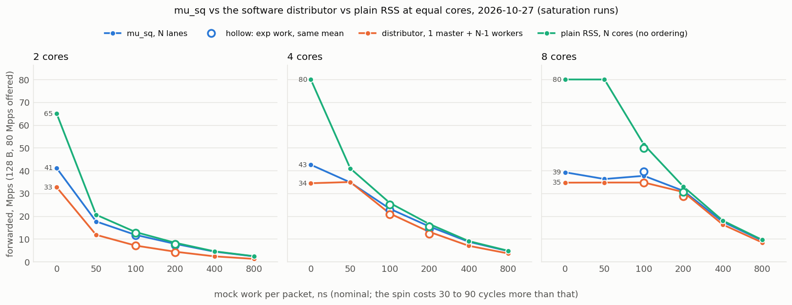

# mu_sq against the software distributor with per-packet work (2026-10-27)

The question left open by finding 17: mu_sq forwards more than the software
distributor when the cores do nothing but forward (the NIC's shared send queue
stops at 42 to 45 Mpps, the distributor's master at 34 to 35), but the
distributor's workers are almost idle there. With real work per packet, which
layout forwards more for the same number of cores, and by how much?

Layouts compared at equal total cores (mu_sq groups are powers of two):

| cores | mu_sq | software distributor | plain RSS (reference) |
|---|---|---|---|
| 2 | 2 lanes | 1 master + 1 worker | 2 run-to-completion cores, one RSS queue each |
| 4 | 4 lanes | 1 master + 3 workers | 4 cores |
| 8 | 8 lanes | 1 master + 7 workers | 8 cores |

Plain RSS has no ordering at all (each core receives and sends on its own
queues), so it is the upper bound: what ordering costs is the distance to it.

## Setup

- Responder on danger51, prom-dpdk mlx5 PMD, `MUSQ_BUILD=o3` binaries.
  mu_sq: the finding-16 command (`--doca-mode esp_rr --pkts-per-wqe 1 --rxd 1024
  --txd 1024 x lanes --devargs mu_sq_comp_n=128 --db-wqes 128`, build-ppw1-o3).
  Distributor: `--masters 2 --lcores <workers> --doca-mode none --musq-group 0
  --rxd 1024 --txd 1024 --rx-burst 64 --tx-burst 64 --dist-chunk 32` (rr order,
  build-nodoca-o3). Plain: `--lcores <cores> --doca-mode none --musq-group 0
  --rxd 1024 --txd 1024 --rx-burst 64 --tx-burst 64`.
- Mock work: `--work fixed:<ns>` spins on the TSC per packet (`exp:<mean>` draws
  the length from an exponential distribution). The spin costs its nominal
  cycles plus 30 to 90 (the TSC reads and the loop), so "50 ns" is 120 nominal
  and about 180 measured cycles; the cycles-per-packet columns show the real cost.
- Requester on danger50, 8 lcores, 128 B frames. mu_sq and the distributor get
  ESP frames encapsulated by the requester's NIC (`--traffic esp --esp-encap hw`,
  126 B on the wire), as in finding 16; the plain layout gets UDP (RSS on ESP
  hashes the IP pair only, 8 flows for 8 lcores, and leaves the queues uneven;
  the UDP requests cycle 16 source ports). Finding 17's UDP sweep showed the
  distributor forwards the same with either.
- Host state: both hosts rebooted 2026-10-27 at 09:25; hugepages, mounts and
  pause off restored before the morning's UDP sweep; **performance governor on
  CPUs 0, 2 to 16 of both hosts and numa_balancing 0 on danger51 set before the
  first run here (13:08)**; the 2026-10-25/27 distributor sweeps ran on
  schedutil, finding 16 on performance. Lane CPUs at 2400 MHz (the Xeon Silver
  4314's maximum).
- Harness in [harness/](harness/): `one_run.sh` (one measurement; `RESP_MODE=musq|dist|plain`,
  `WORK=<spec>`, `TRAFFIC=esp|udp|esp_sw`), `sat.py` (saturation matrix),
  `sweep.py` + `strict_points.py` (finding-16 strict search), `rtt_runs.py` +
  `rtt.py` (latency), `parse_run.py`, `sat_table.py`, `stage2.sh`.

## 1. mu_sq re-baseline on the performance governor (strict rule)

Same method as finding 16 (pass = TX refused and RX lost each <= 0.01 % over the
steady window, three passing runs, 0.5 Mpps steps), ESP, 66 runs, 13:08 to 13:28.
Data: [baseline/](baseline/).

| lanes | frame | today: max Mpps, busy avg, cycles/pkt | next step | finding 16 (2026-10-22): Mpps, busy |
|---|---|---|---|---|
| 2 | 98 | **42.5**, 90.9 %, 102 | 43 refuses 0.012 % | 42, 90.6 % |
| 2 | 128 | **41.5**, 89.8 %, 104 | 42 refuses 0.011 % | 41.5, 88.9 % |
| 2 | 256 | **38**, 84.5 %, 106 | 38.5 refuses 0.018 % | 38, 84.6 % |
| 4 | 98 | **45**, 62.0 %, 132 | 45.5 refuses 0.034 % | 45, 62.1 % |
| 4 | 128 | **44.5**, 60.6 %, 130 | 45 refuses 0.02 % | 44.5, 60.3 % |
| 4 | 256 | **38.5**, 47.8 %, 119 | 39 refuses 0.024 % | 39.5, 48.9 % |
| 8 | 98 | **42.5**, 45.8 %, 206 | 43 refuses 0.02 % | 42, 46.7 % |
| 8 | 128 | **42**, 45.2 %, 206 | 42.5 refuses 0.195 % | 41.5, 44.5 % |
| 8 | 256 | **36**, 35.6 %, 189 | 36.5 refuses 2.527 % | 35.5, 36.6 % |

Every row is within one 0.5 Mpps step of finding 16: the governor does not move
the mu_sq ceilings, and the finding-17 comparison (distributor on schedutil)
stands.

## 2. The work matrix (saturation runs)

One run per point, 80 Mpps offered (above every ceiling), 7 s; the forwarded
rate over the steady window is the layout's capacity, the rest is dropped by the
NIC on RX (CPU-bound points) or refused on TX (the mu_sq wall). 54 runs, 13:28
to 13:43. Data: [sat/sat.csv](sat/sat.csv), run logs in [sat/runs/](sat/runs/);
tables by `harness/sat_table.py`. "core-cyc/pkt" = cores x 2.4 GHz / forwarded
rate: what the whole layout spends per packet, work included.

**2 cores, 128 B** (mu_sq 2 lanes, distributor 1 master + 1 workers, plain 2 RSS cores). Forwarded Mpps under overload; busy % and cycles per packet of the cores.

| work/pkt | mu_sq: Mpps, lanes busy, cyc | distributor: Mpps, master busy, cyc; workers busy, cyc | plain: Mpps, busy, cyc, RX spread | mu_sq vs dist | mu_sq vs plain | core-cyc/pkt mu_sq / dist / plain |
|---|---|---|---|---|---|---|
| fixed:0 | 41.11, 100-100 %, 75-75 | 32.70, 100 %, 73; 32-32 %, 23-23 | 65.06, 88-89 %, 65-65, 0 % | +26 % | -37 % | 117 / 147 / 74 |
| fixed:50 | 17.65, 100-100 %, 269-271 | 11.78, 31 %, 63; 100-100 %, 203-203 | 20.60, 100-100 %, 232-232, 0 % | +50 % | -14 % | 272 / 408 / 233 |
| fixed:100 | 11.75, 100-100 %, 405-408 | 7.05, 19 %, 64; 100-100 %, 339-339 | 12.99, 100-100 %, 369-369, 0 % | +67 % | -10 % | 408 / 681 / 370 |
| exp:100 | 11.47, 100-100 %, 415-418 | 6.97, 19 %, 66; 100-100 %, 343-343 | -, --- %, ---, - % | +65 % | - | 418 / 688 / - |
| fixed:200 | 7.82, 100-100 %, 612-613 | 4.37, 12 %, 64; 100-100 %, 548-548 | 8.30, 100-100 %, 577-577, 0 % | +79 % | -6 % | 614 / 1099 / 578 |
| fixed:400 | 4.38, 100-100 %, 1091-1093 | 2.32, 6 %, 64; 100-100 %, 1031-1031 | 4.53, 100-100 %, 1058-1059, 0 % | +89 % | -3 % | 1096 / 2066 / 1061 |
| fixed:800 | 2.32, 100-100 %, 2063-2064 | 1.20, 3 %, 62; 100-100 %, 1997-1997 | 2.39, 100-100 %, 2003-2003, 0 % | +93 % | -3 % | 2068 / 4000 / 2007 |

**4 cores, 128 B** (mu_sq 4 lanes, distributor 1 master + 3 workers, plain 4 RSS cores). Forwarded Mpps under overload; busy % and cycles per packet of the cores.

| work/pkt | mu_sq: Mpps, lanes busy, cyc | distributor: Mpps, master busy, cyc; workers busy, cyc | plain: Mpps, busy, cyc, RX spread | mu_sq vs dist | mu_sq vs plain | core-cyc/pkt mu_sq / dist / plain |
|---|---|---|---|---|---|---|
| fixed:0 | 42.56, 78-81 %, 94-96 | 34.44, 100 %, 69; 17-18 %, 35-38 | 79.99, 66-69 %, 79-82, 0 % | +24 % | -47 % | 226 / 279 / 120 |
| fixed:50 | 34.80, 100-100 %, 274-275 | 34.97, 100 %, 68; 100-100 %, 205-205 | 40.95, 100-100 %, 234-234, 0 % | -0 % | -15 % | 276 / 275 / 234 |
| fixed:100 | 23.24, 100-100 %, 411-412 | 21.15, 55 %, 62; 100-100 %, 339-339 | 25.80, 100-100 %, 371-371, 0 % | +10 % | -10 % | 413 / 454 / 372 |
| fixed:200 | 15.47, 100-100 %, 617-619 | 13.09, 34 %, 63; 100-100 %, 549-549 | 16.54, 100-100 %, 579-579, 0 % | +18 % | -6 % | 621 / 733 / 580 |
| fixed:400 | 8.72, 100-100 %, 1097-1098 | 6.96, 18 %, 62; 100-100 %, 1031-1031 | 9.03, 100-100 %, 1060-1060, 0 % | +25 % | -3 % | 1101 / 1379 / 1063 |
| fixed:800 | 4.63, 100-100 %, 2069-2069 | 3.60, 9 %, 62; 100-100 %, 1996-1997 | 4.78, 100-100 %, 2005-2005, 0 % | +29 % | -3 % | 2073 / 2669 / 2010 |

**8 cores, 128 B** (mu_sq 8 lanes, distributor 1 master + 7 workers, plain 8 RSS cores). Forwarded Mpps under overload; busy % and cycles per packet of the cores.

| work/pkt | mu_sq: Mpps, lanes busy, cyc | distributor: Mpps, master busy, cyc; workers busy, cyc | plain: Mpps, busy, cyc, RX spread | mu_sq vs dist | mu_sq vs plain | core-cyc/pkt mu_sq / dist / plain |
|---|---|---|---|---|---|---|
| fixed:0 | 39.25, 43-45 %, 103-108 | 34.69, 100 %, 69; 7-8 %, 34-39 | 80.00, 30-31 %, 72-74, 0 % | +13 % | -51 % | 489 / 553 / 240 |
| fixed:50 | 36.28, 100-100 %, 256-258 | 34.75, 100 %, 69; 46-47 %, 220-225 | 80.00, 100-100 %, 239-239, 0 % | +4 % | -55 % | 529 / 553 / 240 |
| fixed:100 | 37.69, 100-100 %, 403-405 | 34.75, 100 %, 69; 73-74 %, 354-358 | 51.37, 100-100 %, 372-374, 0 % | +8 % | -27 % | 509 / 552 / 374 |
| fixed:200 | 31.08, 100-100 %, 615-616 | 30.56, 79 %, 62; 100-100 %, 548-548 | 32.95, 100-100 %, 581-582, 0 % | +2 % | -6 % | 618 / 628 / 583 |
| fixed:400 | 17.45, 100-100 %, 1096-1098 | 16.26, 42 %, 62; 100-100 %, 1030-1031 | 17.99, 100-100 %, 1063-1066, 0 % | +7 % | -3 % | 1100 / 1181 / 1067 |
| fixed:800 | 9.25, 100-100 %, 2070-2070 | 8.39, 22 %, 62; 100-100 %, 1996-1997 | 9.53, 100-100 %, 2009-2010, 0 % | +10 % | -3 % | 2075 / 2288 / 2015 |

What the matrix shows:

- **No work: the two ordered layouts are walls, plain RSS is not.** mu_sq stops
  at 39 to 43 Mpps (the shared send queue; the lanes are 100 % busy at 2 lanes
  because refusals cost cycles, 43 to 45 % at 8 lanes), the distributor at 33 to
  35 (the master at 100 %, 69 to 73 cycles per packet), while plain RSS forwards
  65 Mpps with two cores and the whole 80 Mpps offered with four and eight.
  mu_sq leads the distributor by 13 to 26 % here, as in finding 17.
- **With work the comparison becomes a core count.** From 100 ns per packet on,
  every layout is CPU-bound and forwards cores x 2.4 GHz / (cost per packet):
  a mu_sq lane costs its work plus 75 cycles, a distributor worker its work
  plus 23 (it neither receives nor sends), a plain core its work plus 65. The
  distributor loses one core in N to the master, which is 22 % busy at 800 ns.
  So mu_sq's lead over the distributor approaches N / (N - 1) times the ratio
  of the per-packet costs: 2 cores +67 % at 100 ns, +93 % at 800 ns; 4 cores
  +10 % to +29 %; 8 cores +2 % to +10 %.
- **The one point where they tie:** 4 cores at 50 ns (both 34.8 to 35.0 Mpps).
  The three workers saturate exactly where the master does (3 x 2.4 GHz / 205
  cycles = 35 Mpps), and four mu_sq lanes at 274 cycles reach the same 35.
  Below that work mu_sq is held by its send queue, above it by its lanes.
- **At 8 cores mu_sq is wall-limited up to about 150 ns** (36 to 39 Mpps with
  the lanes at 100 % busy: 8 lanes at 257 cycles could do 75 Mpps), the
  distributor up to about 200 ns (the master's 34.7). Between 100 and 800 ns
  their difference is 2 to 10 %.
- **Against plain RSS, ordering costs little once there is work:** mu_sq is 3 %
  behind plain at 400 and 800 ns at every core count (a lane spends about 60
  cycles per packet more than a plain core on the shared queue's bookkeeping),
  6 % at 200 ns, 10 to 15 % at 50 to 100 ns, and 37 to 51 % with no work. The
  distributor is 3 to 55 % behind plain, by the master's share of the cores.
- In core-cycles per packet (all cores, work included) at 800 ns: plain 2010,
  mu_sq 2075 (+3 %), distributor 2288 to 4000 (+14 % at 8 cores, +100 % at 2).

## 3. Uneven work: `exp:<mean>` against `fixed:<ns>` of the same mean

Both ordered layouts wait for the slowest packet ahead in the order (the NIC
sends mu_sq slots in ring order, the distributor's collector waits for the
worker whose packet is next), so uneven work might cost them more than plain
RSS. Same saturation runs with exponentially distributed work, 18 runs.

| cores | mean work | mu_sq: fixed -> exp Mpps (lane cyc) | distributor: fixed -> exp (worker cyc) | plain: fixed -> exp (core cyc) | mu_sq vs dist, fixed / exp |
|---|---|---|---|---|---|
| 2 | 100 ns | 11.75 -> 11.47 (-2 %; 408 -> 418) | 7.05 -> 6.97 (-1 %; 339 -> 343) | 12.99 -> 12.55 (-3 %; 369 -> 382) | +67 % / +65 % |
| 2 | 200 ns | 7.82 -> 7.29 (-7 %; 613 -> 657) | 4.37 -> 4.10 (-6 %; 548 -> 585) | 8.30 -> 7.69 (-7 %; 577 -> 623) | +79 % / +78 % |
| 4 | 100 ns | 23.24 -> 22.67 (-2 %; 412 -> 422) | 21.15 -> 20.86 (-1 %; 339 -> 344) | 25.80 -> 25.00 (-3 %; 371 -> 383) | +10 % / +9 % |
| 4 | 200 ns | 15.47 -> 14.43 (-7 %; 619 -> 663) | 13.09 -> 12.29 (-6 %; 549 -> 584) | 16.54 -> 15.35 (-7 %; 579 -> 624) | +18 % / +17 % |
| 8 | 100 ns | 37.69 -> 39.49 (+5 %; 405 -> 416) | 34.75 -> 34.72 (-0 %; 358 -> 365) | 51.37 -> 49.83 (-3 %; 374 -> 385) | +8 % / +14 % |
| 8 | 200 ns | 31.08 -> 28.96 (-7 %; 616 -> 661) | 30.56 -> 28.69 (-6 %; 548 -> 584) | 32.95 -> 30.56 (-7 %; 582 -> 628) | +2 % / +1 % |

- **Variance costs nothing at saturation.** Exponential work forwards 1 to 3 %
  less at 100 ns and 6 to 7 % less at 200 ns than fixed work of the same mean,
  but by the same amount in all three layouts, plain RSS included, and the
  cycles per packet rise by the same 10 to 45: that is the cost of the longer
  spins (the exponential draw's realized mean and tail), not of the order.
  mu_sq's lead over the distributor is unchanged (+65 vs +67 %, +9 vs +10 %, +1
  vs +2 %). Under overload every queue is full, so a packet that waits for a
  slower one ahead delays nothing that would otherwise have been sent; the
  variance shows in the latency, not in the throughput.

## 4. Latency

Requester RTT (HdrHistogram over all 8 lcores, `--rx-steer flow`), responder in
`--tx-mode immediate` with `--work header`, so that it answers the request
header and the requester matches every response (100 % matched in every row
below); the service time is carried in the header in whole microseconds, so
the work is 0 or 1 us. mu_sq and the distributor get ESP written by the
requester's lcores (`--esp-encap sw`, readable), plain RSS gets UDP. Two
variants beside the three layouts: mu_sq with the PMD's own doorbell rule
instead of `--db-wqes 128` (`MUSQ_OPTS=""`), and the distributor with
`--dist-chunk 1` instead of 32. 35 runs, 13:50 to 14:24; data in [rtt/](rtt/),
[rtt-musq-dbdefault/](rtt-musq-dbdefault/), [rtt-dist-chunk1/](rtt-dist-chunk1/).
The 4 Mpps rows at 2 and 4 cores with 1 us of work are overloaded (capacity
1 to 4 Mpps) and only show queueing to the ring depth; the 0.5 and 1.5 Mpps rows
replace them.

| service | rate | cores | mu_sq: p50 / p99 / p99.9 us | distributor: p50 / p99 / p99.9 us | plain RSS: p50 / p99 / p99.9 us | mu_sq, PMD doorbell rule: p50 / p99 / p99.9 us | distributor, chunk 1: p50 / p99 / p99.9 us |
|---|---|---|---|---|---|---|---|
| 0 us | 16 Mpps | 2 | 18 / 25 / 26 (cpu 63 %) | 8 / 11 / 12 (cpu 64 %) | 7 / 9 / 11 (cpu 62 %) | 8 / 11 / 12 (cpu 63 %) | - |
| 0 us | 16 Mpps | 4 | 29 / 40 / 42 (cpu 53 %) | 8 / 11 / 12 (cpu 35 %) | 6 / 9 / 10 (cpu 55 %) | 8 / 11 / 12 (cpu 57 %) | - |
| 0 us | 16 Mpps | 8 | 53 / 73 / 76 (cpu 37 %) | 8 / 11 / 12 (cpu 17 %) | 6 / 9 / 10 (cpu 39 %) | 9 / 13 / 14 (cpu 40 %) | 11 / 13 / 14 (cpu 21 %) |
| 0 us | 30 Mpps | 2 | 16 / 20 / 22 (cpu 69 %) | 11 / 14 / 15 (cpu 71 %) | 8 / 12 / 13 (cpu 60 %) | 12 / 15 / 17 (cpu 71 %) | - |
| 0 us | 30 Mpps | 4 | 24 / 29 / 30 (cpu 50 %) | 11 / 14 / 15 (cpu 40 %) | 8 / 12 / 13 (cpu 47 %) | 11 / 14 / 16 (cpu 52 %) | - |
| 0 us | 30 Mpps | 8 | 39 / 46 / 48 (cpu 41 %) | 11 / 13 / 14 (cpu 20 %) | 8 / 12 / 13 (cpu 41 %) | 13 / 18 / 20 (cpu 46 %) | - |
| 1 us | 0.5 Mpps | 2 | 268 / 518 / 528 (cpu 31 %) | 5 / 6 / 6 (cpu 44 %) | 5 / 5 / 6 (cpu 32 %) | 13 / 21 / 21 (cpu 32 %) | - |
| 1 us | 1.5 Mpps | 4 | 188 / 348 / 356 (cpu 47 %) | 16 / 25 / 26 (cpu 48 %) | 5 / 6 / 7 (cpu 48 %) | 12 / 23 / 24 (cpu 47 %) | - |
| 1 us | 4 Mpps | 2 | 1286 / 2131 / 2159 (cpu 100 %, loss 53 %) | 3051 / 3117 / 3185 (cpu 52 %, loss 76 %) | 1059 / 1108 / 1138 (cpu 100 %, loss 52 %) | - | - |
| 1 us | 4 Mpps | 4 | 1289 / 2022 / 2091 (cpu 100 %, loss 6 %) | 2341 / 2393 / 2397 (cpu 77 %, loss 28 %) | 1024 / 1072 / 1078 (cpu 100 %, loss 5 %) | - | - |
| 1 us | 4 Mpps | 8 | 151 / 264 / 268 (cpu 61 %) | 30 / 36 / 37 (cpu 61 %) | 6 / 10 / 11 (cpu 62 %) | 11 / 20 / 21 (cpu 63 %) | 6 / 8 / 9 (cpu 70 %) |

- **Without work both ordered layouts add 1 to 3 us over plain RSS:** at 16 Mpps
  p50 8 to 9 us and p99 11 to 13 against plain's 6 to 7 and 9; at 30 Mpps 11 to
  13 / 14 to 18 against 8 / 12. The distributor's latency does not change with
  the worker count; mu_sq's grows by about 1 us from 2 to 8 lanes.
- **`--db-wqes 128` is a latency tax of 128 WQEs per lane.** With it, mu_sq's
  p50 is 18 / 29 / 53 us at 2 / 4 / 8 lanes and 16 Mpps, i.e. proportional to
  the lane count: a lane rings its doorbell every 128 WQEs, which at 16 Mpps / N
  lanes takes 16 to 64 us (`--tx-drain-us 100` only rescues an idle lane). With
  1 us of work at low rates it is 150 to 270 us p50 and up to 520 us p99. The
  setting bought 1 Mpps of wall in finding 13; for anything latency-sensitive it
  has to be the PMD's own rule, which costs nothing here (same 100 % matched,
  same CPU).
- **With 1 us of work per packet the distributor's chunk of 32 costs latency:**
  p50 16 us at 3 workers and 30 us at 7 (a packet waits behind the chunk ahead
  of its own worker and, in the collector, behind the previous worker's chunk)
  against plain's 5 to 6. `--dist-chunk 1` gives 6 / 8 / 9 us at 8 cores and
  4 Mpps, plain's level, at the master cost measured in finding 17 (125 to
  166 cycles per packet, a ceiling near 19 Mpps). mu_sq with the PMD's doorbell
  sits between: p50 11 to 13 us, p99 20 to 23, the wait for the other lanes'
  slots in ring order.
- Tails are tight in every layout (p99.9 within 2 us of p99); each run has a
  few samples at 100 to 230 us (the "max"), on all layouts alike.

## 5. Strict confirmation of the crossover points

The finding-16 rule (TX refused and RX lost each <= 0.01 % over the steady
window, three passing runs, 0.5 Mpps steps, 0.25 below 20 Mpps) at the points
where the layouts are close, 78 runs, 13:57 to 14:17. Data: [strict/](strict/).

| cores | work | layout | strict max Mpps (busy avg / max) | next step fails | saturation run | strict / saturation |
|---|---|---|---|---|---|---|
| 2 | fixed:100 | distributor | **7** (86 / 100 %) | 7.25: RX, RX loss 3.023 % | 7.05 | -1 % |
| 2 | fixed:100 | mu_sq | **11** (100 / 100 %) | 11.25: TX+RX, refused 0.019 %, RX loss 0.018 % | 11.75 | -6 % |
| 4 | fixed:100 | distributor | **21** (96 / 100 %) | 21.5: RX, RX loss 1.754 % | 21.15 | -1 % |
| 4 | fixed:100 | mu_sq | **22** (100 / 100 %) | 22.5: TX+RX, refused 0.024 %, RX loss 0.012 % | 23.24 | -5 % |
| 4 | fixed:100 | plain RSS | **25** (100 / 100 %) | 25.5: RX, RX loss 1.501 % | 25.80 | -3 % |
| 4 | fixed:50 | distributor | **34** (99 / 100 %) | 34.5: RX, RX loss 0.396 % | 34.97 | -3 % |
| 4 | fixed:50 | mu_sq | **33** (100 / 100 %) | 33.5: TX, refused 0.013 % | 34.80 | -5 % |
| 8 | fixed:100 | distributor | **34** (76 / 100 %) | 34.5: RX, RX loss 0.056 % | 34.75 | -2 % |
| 8 | fixed:100 | mu_sq | **39.5** (94 / 94 %) | 40: TX, refused 0.266 % | 37.69 | +5 % |
| 8 | fixed:200 | distributor | **30.5** (99 / 100 %) | 31: RX, RX loss 1.341 % | 30.56 | -0 % |
| 8 | fixed:200 | mu_sq | **30** (100 / 100 %) | 30.5: TX, refused 0.011 % | 31.08 | -3 % |
| 8 | fixed:200 | plain RSS | **32** (100 / 100 %) | 32.5: RX, RX loss 0.284 % | 32.95 | -3 % |

- **Saturation runs are 1 to 6 % optimistic, mu_sq's more so.** The
  distributor's strict ceiling is 0 to 3 % under its saturation value (it
  fails on RX loss, the knee is sharp: 0.4 to 3 % loss one step up); plain
  RSS 3 % under; mu_sq 3 to 6 % under, except at 8 lanes and 100 ns, where it
  is 5 % *over* (37.7 under overload, 39.5 strict: at the send-queue wall the
  lanes burn cycles on refusals, so overload forwards less than the no-loss
  maximum).
- **Near CPU saturation mu_sq fails on TX refusals, not on RX loss** (every
  mu_sq row above fails "TX" or "TX+RX" with refusals of 0.01 to 0.03 % one step
  up). The lanes are coupled through the shared queue: when one lane falls
  slightly behind, the slots of the others wait for it in ring order and their
  rings fill. The distributor's workers are decoupled by their rings and it
  fails only when a worker is a whole ring behind, on RX.
- **Strict standings:** 4 cores at 50 ns the distributor leads by 3 % (34 vs
  33); at 100 ns mu_sq leads by 5 % at 4 cores (22 vs 21), 16 % at 8 cores (39.5
  vs 34, its wall against the master's) and 57 % at 2 cores (11 vs 7); at
  8 cores and 200 ns the distributor leads by 2 % (30.5 vs 30). Plain RSS is 3
  to 14 % ahead of the better of the two at these points.

## Summary

- mu_sq's advantage over the software distributor is the master core it saves
  and nothing else: with no work it is the shared queue's 39 to 43 Mpps against
  the master's 33 to 35 (+13 to +26 %); with work the lead tends to N / (N - 1)
  corrected by the per-packet costs (lane 75, worker 23, plain core 65 cycles):
  about 2x at 2 cores, +10 to +29 % at 4, +2 to +10 % at 8. They tie at 4 cores
  and 50 ns, and the strict rule hands the distributor 4 cores at 50 ns and 8
  cores at 200 ns by 2 to 3 %, because mu_sq near CPU saturation fails on
  refusals through the coupled lanes.
- Neither layout is close to plain RSS without work (37 to 55 % behind); with
  200 ns or more per packet both are within 3 to 6 % of it at 8 cores, and
  mu_sq within 3 % at 400 ns and up at every core count.
- Work variance changes nothing at saturation.
- Latency: equal for mu_sq and the distributor without work (p50 8 to 13 us, 1
  to 3 us over plain) provided mu_sq runs with the PMD's doorbell rule; with
  1 us of work the distributor needs `--dist-chunk 1` (master cost) to match
  plain, mu_sq is at p50 11 to 13 us.
- Open: a mu_sq group with both a small doorbell batch and the 36 to 42 Mpps
  wall (the `--db-wqes` trade-off has a middle, e.g. 16 or 32, not measured);
  the distributor's chunk against the same trade-off; a split RX-master /
  TX-master pipeline, which would lift the master wall above 35 Mpps at the
  price of a second dedicated core.
