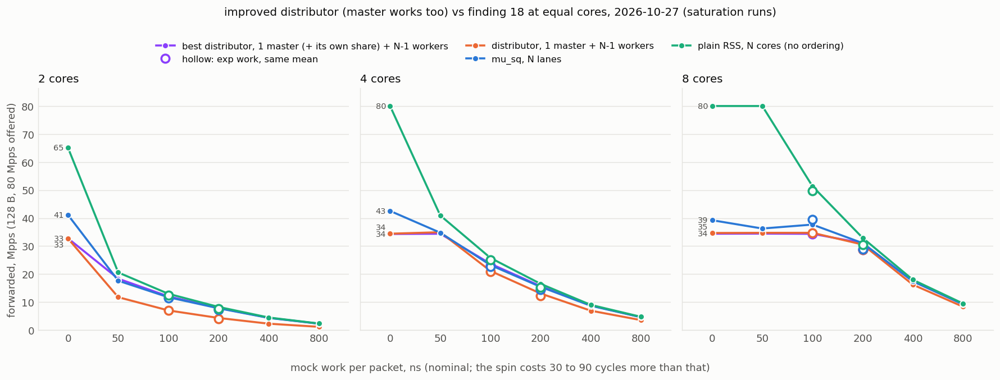

# The improved software distributor against mu_sq (2026-10-27, evening)

Findings 17 to 19 measured the software distributor as first built: one
master that receives, deals to workers over rings, collects in order and
sends. Its two weaknesses against mu_sq at equal cores were the master's wall
(one core's RX + TX, 34 to 35 Mpps, against the shared send queue's 39 to 43)
and, with per-packet work, that the master does no work: N−1 working cores
against mu_sq's N, while the master idles up to 80 %. The user asked for the
best version of the distributor, to evaluate mu_sq against it properly. This
campaign (1) tunes the master's settings and tries the stock DPDK PMD, (2)
makes the master process packets itself whenever the workers are the limit
(`--dist-self`, see the project README, "Software distributor"), and (3)
measures the result against mu_sq, the first distributor and plain RSS of
finding 18 at 2, 4 and 8 cores, 128 B.

**Result:** the single master with `--dist-self 32` equals mu_sq within ±2 % wherever
the cores are the limit (from 50 ns of work per packet at 2 cores, 100 ns
at 4, 200 ns at 8) and is 2 to 3 % ahead at the four strict points; mu_sq
keeps the lead only at the master's wall, 12 to 20 % without work and 5 to
9 % at 8 cores with 50 to 100 ns. The master's settings were already the
optimum; the stock DPDK PMD with two RX queues would add 4 % on the wall.

## Setup

- Responder on danger51, prom-dpdk mlx5 PMD, `MUSQ_BUILD=o3` (build-nodoca-o3
  for the distributor). Best distributor: `--masters 2 --lcores <N-1 workers>
  --doca-mode none --musq-group 0 --rxd 1024 --txd 1024 --rx-burst 64
  --tx-burst 64 --dist-chunk 32 --dist-self 32` (rr order, backlog threshold
  128). mu_sq, the first distributor and plain RSS are finding 18's rows
  (same hosts, same state, 13:00 to 14:25 the same day; the single master's
  rows were confirmed this evening within 1 %, see
  [../swdist-split-2026-10-27](../swdist-split-2026-10-27/README.md)).
- Requester on danger50, 8 lcores, 128 B frames, 80 Mpps offered for the
  saturation runs, ESP encapsulated by the requester's NIC.
- Host state as in finding 18: performance governor on CPUs 0, 2 to 16 of both
  hosts, numa_balancing 0 on danger51, hugepages, mounts and pause off.
- Harness in [harness/](harness/): finding 18's scripts with `RESP_MODE=best`
  (`one_run.sh`, `sat.py` with the master's own share, `strict_points.py`,
  `rtt_runs.py`), `tune.py` (the settings sweep, also an A/B of two binaries),
  `best_table.py`, `best_plot.py`, `stageB.sh`.

## 1. Tuning the master (8 cores, no work, saturation runs)

One run per variant, 7 workers, 128 B, 80 Mpps offered; data in
[tune/](tune/). The master is at 100 % in every row.

| variant | settings | forwarded Mpps | master cyc/pkt | workers cyc/pkt (max) |
|---|---|---|---|---|
| base | bursts 64, chunk 32 (finding 18) | 34.53 | 69 | 40 |
| burst128 | bursts 128, chunk 64 | 34.36 | 70 | 31 |
| rx128tx64 | rx 128, tx 64, chunk 32 | 34.40 | 70 | 37 |
| chunk64 | chunk 64 | 33.96 | 70 | 35 |
| chunk16 | chunk 16 | 32.00 | 75 | 59 |
| chunk8 | chunk 8 | 29.52 | 81 | 77 |
| immediate | + `--tx-mode immediate` | 34.63 | 69 | 38 |
| rxq2 | + `--rx-queues 2` | 34.60 | 69 | 39 |
| rings2048 | rxd, txd 2048 | 34.51 | 69 | 39 |
| rxd4096 | rxd 4096 | 34.08 | 70 | 41 |
| seqn | `--dist-order seqn` | 25.51 | 94 | 42 |
| self32 | + `--dist-self 32` | 34.74 | 69 | 39 |
| stock | stock DPDK v25.11 PMD | 34.28 | 70 | 39 |
| stock_rxq2 | stock PMD + `--rx-queues 2` | 35.96 | 67 | 38 |

- **The finding-18 settings were already the optimum.** Bigger bursts,
  rx 128 with tx 64, immediate TX, deeper rings, two RX queues: all within
  0.5 % of the base. Smaller chunks cost (chunk 16: −7 %, chunk 8: −15 %; the
  ring operations per packet grow), `seqn` costs 25 cycles per packet (the
  collector dequeues from every worker each pass and places every packet in
  the reorder buffer).
- **`--dist-self 32` costs nothing at the wall** (34.7): without work no
  worker ever reaches the backlog threshold, so the master never takes a
  share and runs the same loop.
- **The stock DPDK v25.11 PMD with two RX queues gains 4 %** (36.0 Mpps, 67
  cycles); alone it is equal. The distributor does not need the mu_sq PMD,
  but the comparison is kept on the same PMD as mu_sq, so this is a note, not
  a setting used below.
- **A regression found and fixed on the way:** the first `--dist-self` code
  cost the master 6 to 12 cycles per packet with self switched off (a lambda
  in the per-packet deal loop and a 4 KB staging array on the stack), 29.5 to
  31.9 Mpps instead of 34.5 ([tune-slowbuild/](tune-slowbuild/)). The self
  support is a template flag now, the self-off path compiles to the previous
  code, and the self path uses the same per-packet loop; an A/B against the
  pre-self binary (alternating runs) shows 34.2 to 34.7 for all three.

## 2. The work matrix (saturation runs)

Forwarded Mpps over the steady window with 80 Mpps offered; one run per cell
(`sat.py`), data in [sat/](sat/) (`sat.csv`, `best_tables.md`, per-run logs).
"best" = 1 master with `--dist-self 32` + N−1 workers; "dist" = the same
without self (finding 18); mu_sq N lanes; plain RSS N cores.

| work/pkt, 128 B | 2 cores: best / dist / mu_sq / plain Mpps | 4 cores | 8 cores | best vs dist, 2 / 4 / 8 | best vs mu_sq, 2 / 4 / 8 |
|---|---|---|---|---|---|
| 0 ns | 32.8 / 32.7 / 41.1 / 65.1 | 34.3 / 34.4 / 42.6 / 80 | 34.4 / 34.7 / 39.3 / 80 | +0 / -0 / -1 % | -20 / -19 / -12 % |
| 50 ns | 18.4 / 11.8 / 17.7 / 20.6 | 34.4 / 35.0 / 34.8 / 40.9 | 34.5 / 34.7 / 36.3 / 80 | +56 / -2 / -1 % | +4 / -1 / -5 % |
| 100 ns | 12.1 / 7.1 / 11.8 / 13.0 | 23.7 / 21.1 / 23.2 / 25.8 | 34.4 / 34.8 / 37.7 / 51.4 | +71 / +12 / -1 % | +3 / +2 / -9 % |
| 200 ns | 7.9 / 4.4 / 7.8 / 8.3 | 15.7 / 13.1 / 15.5 / 16.5 | 31.1 / 30.6 / 31.1 / 32.9 | +82 / +20 / +2 % | +1 / +2 / -0 % |
| 400 ns | 4.4 / 2.3 / 4.4 / 4.5 | 8.8 / 7.0 / 8.7 / 9.0 | 17.5 / 16.3 / 17.4 / 18.0 | +91 / +27 / +7 % | +1 / +1 / +0 % |
| 800 ns | 2.3 / 1.2 / 2.3 / 2.4 | 4.7 / 3.6 / 4.6 / 4.8 | 9.3 / 8.4 / 9.3 / 9.5 | +95 / +29 / +10 % | +1 / +0 / +0 % |
| exp:100 | 11.7 / 7.0 / 11.5 / 12.6 | 23.0 / 20.9 / 22.7 / 25.0 | 34.4 / 34.7 / 39.5 / 49.8 | +68 / +10 / -1 % | +2 / +2 / -13 % |
| exp:200 | 7.4 / 4.1 / 7.3 / 7.7 | 14.6 / 12.3 / 14.4 / 15.3 | 28.8 / 28.7 / 29.0 / 30.6 | +80 / +19 / +0 % | +1 / +1 / -1 % |

The master's own share (busy % and cycles per packet received, packets it processed itself):

| work/pkt | 2 cores: master busy, cyc/pkt, self Mpps (share) | 4 cores | 8 cores |
|---|---|---|---|
| 0 ns | 100 %, 73, 0.00 (0 %) | 100 %, 70, 0.00 (0 %) | 100 %, 70, 0.00 (0 %) |
| 50 ns | 99 %, 129, 6.50 (35 %) | 100 %, 70, 0.00 (0 %) | 100 %, 69, 0.00 (0 %) |
| 100 ns | 99 %, 197, 5.00 (41 %) | 99 %, 100, 2.58 (11 %) | 100 %, 70, 0.00 (0 %) |
| 200 ns | 99 %, 300, 3.55 (45 %) | 99 %, 151, 2.59 (16 %) | 99 %, 76, 0.44 (1 %) |
| 400 ns | 99 %, 538, 2.09 (47 %) | 99 %, 270, 1.79 (20 %) | 98 %, 135, 1.14 (7 %) |
| 800 ns | 100 %, 1022, 1.14 (49 %) | 99 %, 511, 1.06 (23 %) | 99 %, 256, 0.87 (9 %) |
| exp:100 | 99 %, 203, 4.87 (42 %) | 99 %, 103, 2.59 (11 %) | 100 %, 70, 0.00 (0 %) |
| exp:200 | 99 %, 323, 3.32 (45 %) | 99 %, 163, 2.47 (17 %) | 98 %, 82, 0.67 (2 %) |

- **Where the workers are the limit, the master's share closes the gap to
  mu_sq entirely.** At 2 cores the best distributor is 1 to 4 % ahead of
  mu_sq from 50 ns of work on (and 56 to 95 % ahead of the first
  distributor): the master processes 40 to 50 % of the packets itself. At 4
  cores it is within ±2 % of mu_sq from 100 ns on (master share 11 to 23 %),
  at 8 cores from 200 ns on (share 1 to 9 %). The exp rows say the same.
- **The master's cost per packet received grows by exactly its share**:
  69 cycles at the wall, 100 at 4 cores and 100 ns with 11 % of the packets
  processed (69 + 0.11 × 340 = 106), 256 at 8 cores and 800 ns with 9 % (69
  + 0.094 × 1996 = 257). It is at 98 to 100 % busy in every row: the idle
  gate hands out exactly the idle cycles.
- **Where the master is the wall nothing changes**: 32.8 / 34.3 / 34.4 Mpps
  without work (the first distributor's 32.7 / 34.4 / 34.7), and 8 cores at
  50 to 100 ns (34.4 to 34.5). No row is below the first distributor beyond
  the 2 % run-to-run spread. mu_sq keeps its lead only there: the shared
  send queue's 36 to 43 Mpps against one core's RX + TX at 34, i.e. 12 to 20 %
  without work, 5 to 9 % at 8 cores with 50 to 100 ns.
- **The first policy was wrong at two points** ([sat-v1/](sat-v1/)): with
  backlog measured as packets outstanding (which counts returns waiting for
  the collector) and no idle gate, the master took a share while it was
  itself the bottleneck (4 cores, 50 ns: 33.0 against 35.0) or stalled its
  dealing so that the workers ran dry (8 cores, 200 ns: 29.2 against 30.6,
  workers at 94 %). Backlog as the worker's input-ring count plus the idle
  gate fixed both (34.4 and 31.1) and changed nothing elsewhere.
- **Plain RSS stays ahead** by 2 to 6 % from 200 ns on (one core's RX + TX
  plus the ring hops against none), by 11 to 20 % at 50 to 100 ns at 2 and 4
  cores, and by far without work at 4 and 8 cores.

## 3. Latency

Requester RTT percentiles, responder `--tx-mode immediate --work header`,
readable ESP, as in finding 18 (`rtt_runs.py`, data in [rtt/](rtt/)).

| service | rate | cores | best distributor: p50 / p99 / p99.9 us | distributor (finding 18): p50 / p99 / p99.9 us | mu_sq, PMD doorbell (finding 18): p50 / p99 / p99.9 us | plain RSS (finding 18): p50 / p99 / p99.9 us |
|---|---|---|---|---|---|---|
| 0 us | 16 Mpps | 2 | 8 / 11 / 12 (cpu 65 %) | 8 / 11 / 12 (cpu 64 %) | 8 / 11 / 12 (cpu 63 %) | 7 / 9 / 11 (cpu 62 %) |
| 0 us | 16 Mpps | 4 | 8 / 11 / 12 (cpu 35 %) | 8 / 11 / 12 (cpu 35 %) | 8 / 11 / 12 (cpu 57 %) | 6 / 9 / 10 (cpu 55 %) |
| 0 us | 16 Mpps | 8 | 8 / 11 / 12 (cpu 18 %) | 8 / 11 / 12 (cpu 17 %) | 9 / 13 / 14 (cpu 40 %) | 6 / 9 / 10 (cpu 39 %) |
| 0 us | 30 Mpps | 4 | 11 / 13 / 14 (cpu 40 %) | 11 / 14 / 15 (cpu 40 %) | 11 / 14 / 16 (cpu 52 %) | 8 / 12 / 13 (cpu 47 %) |
| 0 us | 30 Mpps | 8 | 11 / 13 / 14 (cpu 20 %) | 11 / 13 / 14 (cpu 20 %) | 13 / 18 / 20 (cpu 46 %) | 8 / 12 / 13 (cpu 41 %) |
| 1 us | 0.5 Mpps | 2 | 5 / 6 / 6 (cpu 44 %) | 5 / 6 / 6 (cpu 44 %) | 13 / 21 / 21 (cpu 32 %) | 5 / 5 / 6 (cpu 32 %) |
| 1 us | 1.5 Mpps | 4 | 16 / 24 / 25 (cpu 49 %) | 16 / 25 / 26 (cpu 48 %) | 12 / 23 / 24 (cpu 47 %) | 5 / 6 / 7 (cpu 48 %) |
| 1 us | 4 Mpps | 8 | 31 / 36 / 37 (cpu 61 %) | 30 / 36 / 37 (cpu 61 %) | 11 / 20 / 21 (cpu 63 %) | 6 / 10 / 11 (cpu 62 %) |

- Below capacity the self slot is never taken (no worker is behind), so the
  best distributor's latency is the first distributor's: p50 8 us at 16 Mpps
  and 11 at 30 Mpps without work, 1 to 3 us over plain RSS and equal to or
  under mu_sq; with 1 us of work the chunk of 32 costs p50 16 us at 4 cores
  and 31 at 8 (plain 5 to 6, mu_sq 11 to 12), as in finding 18; at 2 cores
  (one worker, every chunk goes to it at once) it is plain's 5 us. The chunk
  is the latency knob (`--dist-chunk 1` restores plain's level at the
  finding-17 master cost); the self slot adds nothing to it.

## 4. Strict confirmation (finding-16 rule)

Same rule as finding 16 (a fresh responder per run, pass = TX refused and RX
lost each <= 0.01 % over the steady window, three passing runs, 0.5 Mpps
steps, 0.25 below 20 Mpps), at the four points where finding 18 measured
mu_sq and the first distributor under the same rule; 30 runs, 22:26 to 22:34.
Data: [strict/](strict/).

| cores | work | best distributor | mu_sq (finding 18) | distributor (finding 18) | plain RSS (finding 18) | best vs mu_sq |
|---|---|---|---|---|---|---|
| 2 | 100 ns | **11.25** (11.5 fails RX) | 11.0 (11.25 fails TX+RX) | 7.0 | - | +2 % |
| 4 | 50 ns | **34.0** (34.5 fails RX) | 33.0 (33.5 fails TX) | 34.0 | - | +3 % |
| 4 | 100 ns | **22.5** (23 fails RX) | 22.0 (22.5 fails TX+RX) | 21.0 | 25.0 | +2 % |
| 8 | 200 ns | **30.5** (31 fails RX) | 30.0 (30.5 fails TX) | 30.5 | 32.0 | +2 % |

- Under the strict rule the best distributor is 0.25 to 1 Mpps (2 to 3 %)
  ahead of mu_sq at all four points, one step more than the saturation runs
  say: it fails on RX loss only, with the master at 93 to 100 % busy, where
  mu_sq fails on TX refusals one step earlier (a lane slightly behind holds
  the others' slots, finding 18).
- The saturation numbers were 1 to 3 % optimistic for the best distributor
  (12.1 / 34.4 / 23.7 / 31.1 against 11.25 / 34.0 / 22.5 / 30.5), as for the
  other layouts in finding 18.

## Summary

- **The best software distributor on this PMD is the single master with
  `--dist-self 32`**: the finding-18 settings (bursts 64, chunk 32, rr) were
  already the master's optimum, and the self slot lets the master spend its
  idle cycles on packets whenever a worker is behind, without touching the
  path when it is not.
- **It equals mu_sq wherever the cores are the limit**: within ±2 % from 50 ns
  of work per packet at 2 cores, 100 ns at 4 and 200 ns at 8 (saturation),
  and 2 to 3 % ahead at the four strict points. Against the first
  distributor that is up to 2x at 2 cores, +10 to +29 % at 4 cores, +2 to
  +10 % at 8 cores, and never worse.
- **mu_sq's remaining advantage is the single-stream wall only**: the shared
  send queue forwards 36 to 43 Mpps at 128 B where one core's RX + TX stops
  at 34 (12 to 20 % without work, 5 to 9 % at 8 cores with 50 to 100 ns). The
  per-core efficiency of the two schemes is the same within a few cycles.
- Plain RSS stays 2 to 6 % ahead of both from 200 ns on, and far ahead
  without work; the ordering costs that much and no more.
- Latency is the first distributor's (the self slot is never taken below
  capacity); the chunk of 32 remains the latency knob.
- Still open: the stock PMD with two RX queues (+4 % on the wall), a NIC
  core + dealer core split (estimate +8 to 15 % on the wall, one core more),
  `--dist-self` together with `--dist-chunk 1` for latency, larger frames.

## Addendum 2026-10-29: counted by worker cores

The user's rule for the comparison: N counts the distributor's **workers**,
not its master, so mu_sq N lanes stands against 1 master + N workers (N + 1
cores). Measured 2026-10-29 after a reboot with the host state restored
(hugepages, pause off, performance governor on CPUs 0 and 2 to 18, numa_balancing
0 on danger51); a repeat of the 2026-10-27 point "best, 8 cores, no work" gave
34.4 Mpps against 34.4 then. Same settings
(`--dist-self 32`, bursts 64, chunk 32), same traffic, 128 B. Data in
[sat-workers/](sat-workers/), [strict-workers/](strict-workers/),
[rtt-workers/](rtt-workers/); the workbook
[../musq-vs-distributor-2026-10-27.xlsx](../musq-vs-distributor-2026-10-27.xlsx)
holds this view with its charts. Harness: `RESP_MODE=bestw` (`one_run.sh`,
`stageD.sh`).

Saturation runs (80 Mpps offered), forwarded Mpps:

| work/pkt, 128 B | N = 2: distributor / mu_sq / plain Mpps | N = 4 | N = 8 | distributor vs mu_sq, 2 / 4 / 8 |
|---|---|---|---|---|
| no work | 34.2 / 41.1 / 65.1 | 34.0 / 42.6 / 80 | 34.4 / 39.3 / 80 | -17 / -20 / -12 % |
| 50 ns | 27.1 / 17.7 / 20.6 | 34.3 / 34.8 / 40.9 | 34.4 / 36.3 / 80 | +53 / -1 / -5 % |
| 100 ns | 17.9 / 11.8 / 13.0 | 29.4 / 23.2 / 25.8 | 33.5 / 37.7 / 51.4 | +52 / +27 / -11 % |
| 200 ns | 11.8 / 7.8 / 8.3 | 19.6 / 15.5 / 16.5 | 34.3 / 31.1 / 32.9 | +51 / +27 / +10 % |
| 400 ns | 6.6 / 4.4 / 4.5 | 11.0 / 8.7 / 9.0 | 19.6 / 17.4 / 18.0 | +51 / +26 / +12 % |
| 800 ns | 3.5 / 2.3 / 2.4 | 5.8 / 4.6 / 4.8 | 10.4 / 9.3 / 9.5 | +51 / +25 / +12 % |

Strict rule (finding 16), every point where mu_sq has a strict number:

| N | work/pkt | distributor (1 + N) | mu_sq (N lanes) | distributor vs mu_sq |
|---|---|---|---|---|
| 2 | 0 ns | 33.5 | 41.5 | -19 % |
| 2 | 100 ns | 17.25 | 11.0 | +57 % |
| 4 | 0 ns | 34.0 | 44.5 | -24 % |
| 4 | 50 ns | 34.0 | 33.0 | +3 % |
| 4 | 100 ns | 28.5 | 22.0 | +30 % |
| 8 | 0 ns | 34.0 | 42.0 | -19 % |
| 8 | 100 ns | 34.0 | 39.5 | -14 % |
| 8 | 200 ns | 34.0 | 30.0 | +13 % |

- Without work the distributor is its master's wall at 34 Mpps for any N,
  12 to 20 % under mu_sq's queue (39 to 43). With work it is ahead by about
  the extra core: +51 to +53 % with 2 workers from 50 ns on, +25 to +27 % with
  4 workers from 100 ns on, +10 to +12 % with 8 workers from 200 ns on (the
  master takes 10 to 31 % of the packets itself at N = 2, 4 to 17 % at N = 4,
  up to 8 % at N = 8). mu_sq keeps the lead at N = 8 up to 100 ns (5 to 11 %),
  where the master is still the limit.
- Strict: the distributor at 17.25 / 28.5 / 34.0 Mpps against mu_sq's 11.0 /
  22.0 / 30.0 at (2, 100 ns), (4, 100 ns), (8, 200 ns); at (4, 50 ns) 34.0
  against 33.0; at 0 ns and (8, 100 ns) mu_sq ahead, 41.5 to 44.5 and 39.5
  against the master's 33.5 to 34.0.
- Latency: p50 8 us at 16 Mpps and 11 at 30 Mpps for N = 2, 4, 8 (the same as
  with N - 1 workers); with 1 us of work 5 / 17 / 30 us at N = 2 / 4 / 8.
