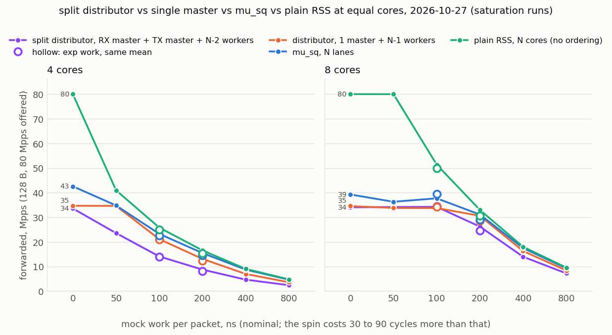

# The split distributor: RX master and TX master on two lcores (2026-10-27)

Finding 18 left the software distributor's ceiling at the master: one core's
RX plus TX cost, 69 cycles per packet, 34 to 35 Mpps whatever the worker count.
The obvious lever is to split the master over two lcores, a two-stage pipeline:
an **RX master** that receives and deals, a **TX master** that collects the
workers' returns in arrival order and sends. If the two halves cost half each,
the wall doubles and the distributor beats mu_sq's 39 to 43 Mpps queue with the
cores to spare. This campaign implements that (`--tx-masters`, see the project
README, "Software distributor") and measures it against the single-master
distributor, mu_sq and plain RSS at equal total cores.

**Result: the split does not move the wall.** The RX master alone costs 70 to
71 cycles per packet, as much as the whole single master, and the TX master
another 60: the mbuf's hand-over between the two cores (one cache line written
by the RX PMD on one core, read by the TX PMD on the other, and written again
on the next refill) costs more than the TX work it takes away. The split
forwards 33.6 to 34.2 Mpps where the single master forwards 33.8 to 34.7, and
with work it has one worker fewer.

Layouts at equal total cores (the split needs at least three):

| cores | split distributor | distributor | mu_sq | plain RSS |
|---|---|---|---|---|
| 4 | RX master + TX master + 2 workers | 1 master + 3 workers | 4 lanes | 4 cores |
| 8 | RX master + TX master + 6 workers | 1 master + 7 workers | 8 lanes | 8 cores |

## Setup

- Responder on danger51, prom-dpdk mlx5 PMD, `MUSQ_BUILD=o3` binaries
  (build-nodoca-o3 for the two distributor layouts). Split: `--masters 2
  --tx-masters 4 --lcores 6,8,... --doca-mode none --musq-group 0 --rxd 1024
  --txd 1024 --rx-burst 64 --tx-burst 64 --dist-chunk 32` (rr order).
  Single master: the finding-18 command (`--masters 2 --lcores 4,6,...`, same
  options). Both were rebuilt today (the master loop was reorganised for the
  split: the link state is in dealer-owned and collector-owned cache lines, the
  dealer reads the collector's counts lazily), so the single master was
  measured again; mu_sq and plain RSS are finding 18's numbers of this
  afternoon (same hosts, same state, same traffic, 6 hours earlier).
- Requester on danger50, 8 lcores, 128 B frames, 80 Mpps offered (saturation
  runs); ESP encapsulated by the requester's NIC as in finding 18.
- Host state as in finding 18: performance governor on CPUs 0, 2 to 16 of both
  hosts, numa_balancing 0 on danger51, hugepages, mounts and pause off.
- Functional checks before the runs (2 Mpps UDP with `--work header`): every
  request matched, none lost, `Ring retries` 0, for rr and for seqn + lb with
  `--tx-mode immediate`; stream test (finding 9: one flow, 16 M chunks of
  184 B, ESP 256 B at 4 Mpps, six workers with `--work exp:300`): IDENTICAL
  for rr and for seqn.
- Harness in [harness/](harness/): finding 18's scripts with `RESP_MODE=split`
  (`one_run.sh`, `sat.py` with TX master columns, `strict_points.py`,
  `rtt_runs.py`), `split_table.py`, `split_rtt_table.py`, `split_plot.py`,
  `stage1.sh`. Runs 20:28 to 20:39 (matrix and latency), 20:41 on (strict).

## 1. The work matrix (saturation runs)

Forwarded Mpps over the steady window with 80 Mpps offered; one run per cell
(`sat.py`), data in [sat/](sat/) (`sat.csv`, `split_tables.md`, per-run logs).

| work/pkt, 128 B | 4 cores: split / dist / mu_sq / plain Mpps | 8 cores | split vs dist, 4 / 8 | split vs mu_sq, 4 / 8 |
|---|---|---|---|---|
| 0 | 33.6 / 34.7 / 42.6 / 80 | 34.0 / 34.5 / 39.3 / 80 | -3 / -1 % | -21 / -13 % |
| 50 ns | 23.6 / 34.6 / 34.8 / 41.0 | 34.2 / 33.8 / 36.3 / 80 | -32 / +1 % | -32 / -6 % |
| 100 ns | 14.1 / 21.1 / 23.2 / 25.8 | 34.2 / 33.7 / 37.7 / 51.4 | -33 / +1 % | -39 / -9 % |
| 200 ns | 8.7 / 13.1 / 15.5 / 16.5 | 26.2 / 30.6 / 31.1 / 33.0 | -33 / -14 % | -44 / -16 % |
| 400 ns | 4.7 / 7.0 / 8.7 / 9.0 | 13.9 / 16.3 / 17.5 / 18.0 | -33 / -14 % | -47 / -20 % |
| 800 ns | 2.4 / 3.6 / 4.6 / 4.8 | 7.2 / 8.4 / 9.3 / 9.5 | -33 / -14 % | -48 / -22 % |
| exp:100 | 13.9 / 20.9 / 22.7 / 25.0 | 34.5 / 34.2 / 39.5 / 49.8 | -33 / +1 % | -39 / -13 % |
| exp:200 | 8.2 / 12.3 / 14.4 / 15.4 | 24.6 / 28.7 / 29.0 / 30.6 | -33 / -14 % | -43 / -15 % |

The full tables with the busy % and cycles per packet of every core are in
[sat/split_tables.md](sat/split_tables.md). What they show:

- **The RX master is the wall, at the single master's cost.** Without work the
  RX master runs at 99 % busy and 70 to 71 cycles per packet (33.6 to 34.0
  Mpps); the single master at 100 % and 69 (34.5 to 34.7). The TX master is at
  84 to 85 % and 60 cycles, so a second split of its half would not help
  either: together the two halves spend 130 cycles per packet on what one core
  does in 69.
- **The hand-over costs 25 cycles per packet unloaded and 60 saturated.** At 8
  cores and 400 to 800 ns of work, where the masters idle, the RX master costs
  51 and the TX master 36 to 37 cycles per packet (87 together) against the
  single master's 62 to 63; at the wall it is 131 against 69. What crosses the
  cores is the mbuf itself: its first cache line is written by the RX PMD on
  the RX master (refill), read by the TX PMD on the TX master (send) and
  written again by the RX master on the next refill, which has to take the
  line back from the TX master each time; and the pointer takes the long way
  round through the mempool ring (the TX master's free fills its own cache,
  flushed to the pool in bulk; the RX master refills from there). The link
  state itself is cheap by design: one FIFO line per 8 packets, and the
  collector's counter only when a worker is at the limit (never, here).
- **With work the split has one worker fewer, and that is the whole story.**
  From 200 ns on at 8 cores the workers saturate and the split forwards 6/7 of
  the single master (-14 %); at 4 cores 2/3 (-33 %). In the band where the
  single master is the limit and the split's 6 workers are not (8 cores, 50
  to 100 ns) the split is +1 %, within one run's noise. Uneven work changes
  nothing.
- **Against mu_sq the split is 13 to 48 % behind everywhere**, the single
  master 2 to 29 % (finding 18). The one layout that would have made the
  distributor competitive without work, a doubled master wall, did not
  materialise.

## 2. Latency

Requester RTT percentiles, responder `--tx-mode immediate --work header`,
readable ESP, as in finding 18 (`rtt_runs.py`, data in [rtt/](rtt/)). The split
rows are today's; the single master was run again today at 16 and 30 Mpps, its
1 us rows and the mu_sq and plain rows are finding 18's.

| service | rate | cores | split: p50 / p99 / p99.9 us | distributor (today): p50 / p99 / p99.9 us | distributor (finding 18): p50 / p99 / p99.9 us | mu_sq, PMD doorbell (finding 18): p50 / p99 / p99.9 us | plain RSS (finding 18): p50 / p99 / p99.9 us |
|---|---|---|---|---|---|---|---|
| 0 us | 16 Mpps | 4 | 8 / 11 / 12 (cpu 45 %) | 8 / 11 / 12 (cpu 34 %) | 8 / 11 / 12 (cpu 35 %) | 8 / 11 / 12 (cpu 57 %) | 6 / 9 / 10 (cpu 55 %) |
| 0 us | 16 Mpps | 8 | 8 / 11 / 12 (cpu 23 %) | 8 / 11 / 12 (cpu 17 %) | 8 / 11 / 12 (cpu 17 %) | 9 / 13 / 14 (cpu 40 %) | 6 / 9 / 10 (cpu 39 %) |
| 0 us | 30 Mpps | 4 | 10 / 12 / 13 (cpu 62 %) | 11 / 13 / 14 (cpu 39 %) | 11 / 14 / 15 (cpu 40 %) | 11 / 14 / 16 (cpu 52 %) | 8 / 12 / 13 (cpu 47 %) |
| 0 us | 30 Mpps | 8 | 10 / 12 / 13 (cpu 31 %) | 11 / 13 / 14 (cpu 20 %) | 11 / 13 / 14 (cpu 20 %) | 13 / 18 / 20 (cpu 46 %) | 8 / 12 / 13 (cpu 41 %) |
| 1 us | 1.5 Mpps | 4 | 17 / 23 / 26 (cpu 49 %) | - | 16 / 25 / 26 (cpu 48 %) | 12 / 23 / 24 (cpu 47 %) | 5 / 6 / 7 (cpu 48 %) |
| 1 us | 4 Mpps | 8 | 31 / 36 / 36 (cpu 61 %) | - | 30 / 36 / 37 (cpu 61 %) | 11 / 20 / 21 (cpu 63 %) | 6 / 10 / 11 (cpu 62 %) |

- Without work the split is equal to the single master at 16 Mpps (p50 8 us)
  and 1 us better at 30 Mpps (p50 10 against 11): the TX side sends as soon
  as the returns are in instead of after the next RX burst. Both are 2 us over
  plain RSS and equal to or better than mu_sq.
- With 1 us of work per packet the split's chunk of 32 costs exactly what the
  single master's does (p50 17 us with 2 workers at 1.5 Mpps, 31 us with 6
  workers at 4 Mpps): the chunk, not the master's structure, sets it (finding
  18: `--dist-chunk 1` brings it to plain's level).

## 3. Strict confirmation (finding-16 rule)

Same rule as finding 16: a fresh responder per run, pass = TX refused <= 0.01 %
and RX loss <= 0.01 % over the steady window, ladder +2 Mpps, bisect to 0.5,
three passing runs at the reported rate; 42 runs, 20:41 to 20:53. Search from
1.5 Mpps below each saturation value. Data: [strict/](strict/) (`cases/`,
`runs.csv`, `sweep.log`).

| layout | cores | work | strict max Mpps | next step | saturation run | master busy | TX master busy | workers busy |
|---|---|---|---|---|---|---|---|---|
| split | 4 | 0 | **33.5** | 34 fails RX (1.2 % lost) | 33.6 | 99 % (RX master) | 84 % | 31 to 34 % |
| distributor | 4 | 0 | **34.0** | 34.5 fails RX (0.5 %), passed 1 of 2 | 34.7 | 100 % | - | 17 to 18 % |
| split | 8 | 0 | **33.5** | 34 fails RX (0.6 %) | 34.0 | 98 % (RX master) | 84 % | 11 to 12 % |
| distributor | 8 | 0 | **34.0** | 34.5 fails RX (0.9 %), passed 2 of 3 | 34.5 | 100 % | - | 7 to 8 % |
| split | 8 | 100 ns | **33.5** | 34 fails RX (0.15 %), passed 1 of 2 | 34.2 | 96 % (RX master) | 77 % | 84 to 85 % |
| distributor | 8 | 100 ns | **34.0** | 34.5 fails RX (2.4 %) | 33.7 | 100 % | - | 72 % |

- **The split is one 0.5 Mpps step below the single master in all three
  pairs** (33.5 against 34.0), with or without work and whatever the worker
  count: the RX master's wall, not the workers. Both layouts fail on RX loss
  (the NIC's RX ring overflows while the master, or RX master, is busy; the
  workers are nowhere near their in-flight limit, `RX held passes` stays 0).
- The saturation runs were 0 to 2 % optimistic (34.0 to 34.2 against 33.5,
  34.5 to 34.7 against 34.0), as in finding 18; the single master at 8 cores
  and 100 ns went the other way (33.7 saturated, 34.0 strict).

## Summary

- The RX master / TX master split of the software distributor is implemented
  (`--tx-masters`, both orderings, verified by the matching and stream tests)
  and **does not raise the distributor's wall**: 33.6 to 34.2 Mpps against the
  single master's 33.8 to 34.7 at 128 B, because moving the mbuf between the
  two cores costs 25 cycles per packet unloaded and 60 at the wall, more than
  the TX work it moves. With work it is strictly worse, by its missing worker.
- The master's 69 cycles are the NIC work (one core's RX and TX), not the
  dealing and collecting; nothing that keeps the NIC work on two cores can
  avoid the hand-over, so the wall of a single-stream software distributor is
  one core's RX + TX cost on this PMD.
- Still open: a **NIC core + dealer core** split, where one core does RX and
  TX (the mbufs never leave it; it hands tokens to a dealer core and takes
  back counts in order) and the dealer does the dealing and collecting. It
  removes only the dealing and collecting from the NIC core (about 15 cycles)
  and adds two ring hops (about 6), so the estimate is 37 to 40 Mpps, +8 to
  15 %, mu_sq's 8-lane level, for one core more. **Several masters over RSS**
  (`--masters 2,10`, already supported) double the wall but split the stream
  into flows, which is a different problem from mu_sq's.
